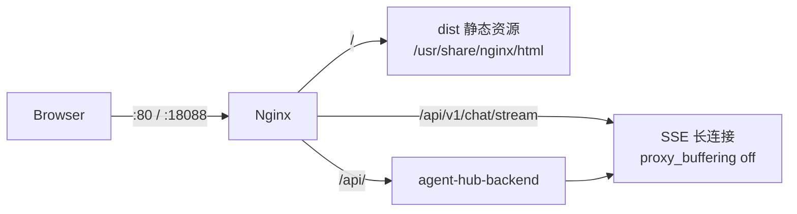

# 部署产物：Nginx 配置与 SSE 验证

本目录交付 Agent Hub Web 的生产环境 Nginx 配置，以及一个可在本机 Docker 环境中复跑的
SSE 行为验证脚本。目标是把「静态资源 + 同源 API 反代 + 聊天流式响应」这一条链路固定下来，
并用实测时间线证明 SSE 关键指令确实生效。

## 1. 文件清单

| 文件                               | 作用                                                                                                                                                 |
| ---------------------------------- | ---------------------------------------------------------------------------------------------------------------------------------------------------- |
| `deploy/nginx.conf`                | 完整 `nginx.conf`：`upstream`、SPA fallback、`/assets/` 长缓存、`/api/` 基础反代、`/api/v1/chat/stream` 专用 SSE location、`/healthz` `/readyz` 透传 |
| `scripts/verify-nginx-sse.mjs`     | 在 `dev_nginx` 容器内启动临时 nginx 与假 SSE 源，实测 `/sse` 逐帧、`/sse-buffered` 缓冲两种路径；`--check-deploy` 只校验交付配置语法                 |
| `package.json` 中的 `verify:nginx` | `node scripts/verify-nginx-sse.mjs`（由仓库根维护，本目录不重复定义）                                                                                |

> `deploy/nginx.conf` 是**完整 nginx.conf**（含 `events` / `http` / `server`），不是
> `/etc/nginx/conf.d/*.conf` 片段。若部署平台只允许投放 conf.d 片段，请把 `server { ... }`
> 拆出，并确保主配置的 `http` 块中存在同名 `upstream agent-hub-backend`。

## 2. 部署拓扑



前端生产构建使用同源相对路径 `/api/v1`（`.env.production` 中
`VITE_API_BASE_URL=` 留空、`VITE_USE_MOCK=false`），因此浏览器不需要跨域配置；
Nginx 负责把 `/api/` 转发到后端。

## 3. 部署步骤

### 3.1 构建前端

```bash
pnpm install
pnpm build          # 输出 dist/
```

确认 `dist/index.html` 与 `dist/assets/*` 存在。生产构建必须关闭 mock
（`VITE_USE_MOCK=false`），否则构建会按仓库守卫失败。

### 3.2 放置静态文件

把 `dist/` 内容放到 `deploy/nginx.conf` 中 `root` 指向的目录，默认：

```text
/usr/share/nginx/html/
  index.html
  assets/index-<hash>.js
  assets/index-<hash>.css
  ...
```

使用容器部署时，建议以只读方式挂载：

```yaml
services:
  web:
    image: nginx:alpine
    ports:
      - '18088:80'
    volumes:
      - ./dist:/usr/share/nginx/html:ro
      - ./deploy/nginx.conf:/etc/nginx/nginx.conf:ro
    depends_on:
      - agent-hub-backend

  agent-hub-backend:
    # 后端服务；容器网络内主机名为 agent-hub-backend
    expose:
      - '8000'
```

### 3.3 修改 upstream 与 root

`deploy/nginx.conf` 默认值：

```nginx
upstream agent-hub-backend {
    server 127.0.0.1:8000;   # 按实际部署修改
    keepalive 32;
}

root /usr/share/nginx/html;  # 按实际静态目录修改
```

注意：`127.0.0.1:8000` 只在「nginx 与后端同主机/同网络命名空间」时成立。
如果 nginx 与后端分别运行在 Docker Compose 的两个容器中，应改为服务名：

```nginx
upstream agent-hub-backend {
    server agent-hub-backend:8000;
    keepalive 32;
}
```

若后端在宿主机、nginx 在容器内，则需使用 `host.docker.internal:8000`
（Docker Desktop）或宿主机网关地址，不能写容器内的 `127.0.0.1`。

### 3.4 替换配置并重载

在**可写**的部署环境（镜像构建阶段、Kubernetes ConfigMap、Compose 只读挂载等）中：

```bash
# 先备份
cp /etc/nginx/nginx.conf /etc/nginx/nginx.conf.bak

# 写入新配置（示例：从构建上下文复制）
cp deploy/nginx.conf /etc/nginx/nginx.conf

# 语法检查 + 平滑重载
nginx -t
nginx -s reload
```

> 本机 `dev_nginx` 的 `/etc/nginx` 是宿主目录的**只读 bind mount**，不能直接写入或
> reload 注入。因此本仓库的验证脚本不会修改它，而是在容器 `/tmp` 下用
> `nginx -c /tmp/.../sse.conf` 启动独立实例做实验。正式配置以 `deploy/nginx.conf` 交付，
> 由实际部署环境负责挂载/替换。

### 3.5 部署后冒烟检查

```bash
# 首页（宿主映射端口按实际环境替换）
curl --noproxy '*' -sS -o /dev/null -w 'index: %{http_code}\n' http://127.0.0.1:18088/

# 健康检查需要后端已启动
curl --noproxy '*' -sS -o /dev/null -w 'healthz: %{http_code}\n' http://127.0.0.1:18088/healthz
curl --noproxy '*' -sS -o /dev/null -w 'readyz: %{http_code}\n' http://127.0.0.1:18088/readyz
```

## 4. 配置要点

### 4.1 SPA fallback 与缓存

| 路径            | 配置                                              | 目的                                                                                                |
| --------------- | ------------------------------------------------- | --------------------------------------------------------------------------------------------------- |
| `/`             | `try_files $uri $uri/ /index.html`                | 刷新前端路由（如 `/chat/xxx`）时回落到入口 HTML                                                     |
| `/assets/`      | `expires 1y` + `Cache-Control: public, immutable` | Vite 产物文件名带内容哈希，可安全长缓存；`try_files $uri =404` 防止把 `index.html` 当成 JS/CSS 返回 |
| `= /index.html` | `Cache-Control: no-cache`                         | 入口 HTML 不缓存，用户才能及时拿到新版本引用的新 assets                                             |

### 4.2 API 与 SSE

`/api/` 走普通反代（`proxy_read_timeout 60s`）。聊天流使用**精确匹配**的
`location = /api/v1/chat/stream`，覆盖 `/api/` 的前缀匹配：

| 指令                             | 作用                                                                                   |
| -------------------------------- | -------------------------------------------------------------------------------------- |
| `proxy_http_version 1.1`         | 与后端使用 HTTP/1.1，支持 chunked/长连接；HTTP/1.0 不适合长流                          |
| `proxy_set_header Connection ""` | 清除逐跳 `Connection` 头，避免把 `Connection: close` 传给后端，配合 upstream keepalive |
| `proxy_buffering off`            | 后端每产生一个事件就立即转发，不攒 buffer、不等响应结束；**逐帧流式的关键**            |
| `proxy_cache off`                | 禁止缓存流式响应，避免中间层缓存半截事件或复用旧流                                     |
| `gzip off`                       | 压缩器会额外缓冲，破坏事件实时性；SSE 文本很小，压缩收益有限                           |
| `proxy_read_timeout 3600s`       | 模型可能长时间不产出下一个 chunk；默认 60s 会 504 中断 SSE                             |
| `proxy_send_timeout 3600s`       | 客户端网络慢时，给 nginx 足够时间写完事件                                              |
| `proxy_connect_timeout 10s`      | 后端不可用时快速失败，不把连接建立也拖到一小时                                         |

### 4.3 健康检查

`/healthz`、`/readyz` 用精确 location 透传到后端同名路径，不经过 SPA fallback。
编排/负载均衡探活应直接访问这两个路径。

## 5. 验证命令

```bash
# 完整行为验证：临时 nginx + 假 SSE 源 + 逐帧时间线
pnpm verify:nginx
# 等价于
node scripts/verify-nginx-sse.mjs

# 仅校验 deploy/nginx.conf 语法（不监听端口、不连接上游）
pnpm verify:nginx --check-deploy
# 等价于
node scripts/verify-nginx-sse.mjs --check-deploy
```

环境变量：

| 变量                | 默认值                                                  | 说明                 |
| ------------------- | ------------------------------------------------------- | -------------------- |
| `NGINX_CONTAINER`   | `dev_nginx`                                             | 承载临时实例的容器名 |
| `NGINX_HOST_PORT`   | 自动读取 `docker port <container> 80/tcp`，回退 `18088` | 宿主访问端口         |
| `NGINX_SOURCE_PORT` | `18999`                                                 | 容器内假 SSE 源端口  |

脚本的关键行为：

1. 检查 Docker、容器 `dev_nginx`、容器内 `nginx` / busybox `nc` / `netstat`；
2. 在容器 `/tmp/agent-hub-sse-verify/` 写入 `serve.sh` 与 `sse.conf`；
3. 启动 `nc -lk -p 18999 -e serve.sh` 假源；
4. 检查容器 80 未被占用（若被占用则明确报错退出，**不 kill 主进程**）；
5. 启动 `nginx -c /tmp/.../sse.conf` 临时实例（独立 pid/error_log，不触碰主 nginx）；
6. 宿主 Node 客户端设置 `NO_PROXY=*`，分别流式读取
   `http://127.0.0.1:<hostPort>/sse` 与 `/sse-buffered`，记录逐帧到达毫秒；
7. 断言：
   - `/sse`：相邻帧间隔 ≥ 500 ms，且 5 帧跨度 ≥ 3 s；
   - `/sse-buffered`：5 帧在 ≤ 1 s 内集中到达，或首帧延迟 ≥ 4 s；
8. `finally` 清理临时 nginx/nc/serve.sh 子进程与 `/tmp` 目录，并确认端口释放；
9. 退出码：全部通过 `0`，任一失败 `1`。

## 6. 验证记录

### 6.1 完整 SSE 验证

- 执行时间：2026-11-11（Asia/Shanghai）
- 环境：WSL2 + Docker Desktop，容器 `dev_nginx`（nginx/1.31.1），
  宿主 `127.0.0.1:18088 -> 容器 80`
- 命令：`node scripts/verify-nginx-sse.mjs`
- 结果：**exit 0 / PASS**

`/sse`（`proxy_buffering off`）逐帧时间线：

| 帧  | 到达时间 | 相邻间隔 | 数据      |
| --- | -------: | -------: | --------- |
| #1  |    21 ms |    21 ms | `data: 1` |
| #2  |  1019 ms |   999 ms | `data: 2` |
| #3  |  2020 ms |  1001 ms | `data: 3` |
| #4  |  3022 ms |  1002 ms | `data: 4` |
| #5  |  4023 ms |  1001 ms | `data: 5` |

断言：相邻帧最小间隔 999 ms ≥ 500 ms；5 帧跨度 4002 ms ≥ 3000 ms → **PASS**。

`/sse-buffered`（默认 `proxy_buffering on`）时间线：

| 帧  | 到达时间 | 相邻间隔 | 数据      |
| --- | -------: | -------: | --------- |
| #1  |  5030 ms |  5030 ms | `data: 1` |
| #2  |  5030 ms |     0 ms | `data: 2` |
| #3  |  5030 ms |     0 ms | `data: 3` |
| #4  |  5030 ms |     0 ms | `data: 4` |
| #5  |  5030 ms |     0 ms | `data: 5` |

断言：5 帧跨度 0 ms ≤ 1000 ms，首帧延迟 5030 ms（缓冲路径集中到达）→ **PASS**。

同一环境多次运行结果一致：逐帧路径约 1 s/帧、跨度约 4 s；缓冲路径约 5 s 时
5 帧同时到达。

清理输出摘要：

```text
- 临时 nginx 已停止，容器 80 端口已释放
- 已终止残留 serve.sh 进程 1 个
- 假 SSE 源已停止，容器 18999 端口已释放
- 已删除容器内临时目录 /tmp/agent-hub-sse-verify*
```

清理后独立复核：容器内只剩主 nginx（PID 1 + worker）与 Docker DNS 监听
`127.0.0.11:34833`；`/tmp` 无验证残留；宿主 `18088` 恢复连接 reset（主 nginx
无 server 配置、不监听 80，符合验证前状态）；宿主无 `verify-nginx` / `nc` 验证进程。

### 6.2 `--check-deploy` 语法检查

- 命令：`node scripts/verify-nginx-sse.mjs --check-deploy`
- 结果：**exit 0 / PASS**
- `nginx -t` 输出摘要：

```text
nginx: the configuration file /tmp/agent-hub-sse-verify-deploy/deploy-check.conf syntax is ok
nginx: configuration file /tmp/agent-hub-sse-verify-deploy/deploy-check.conf test is successful
```

- 检查过程摘要：
  - `deploy/nginx.conf` 已是完整 nginx.conf（含 `events/http`）；
  - `upstream agent-hub-backend` 已存在（保留原地址）;
  - `root` 替换为容器内临时目录 `/tmp/agent-hub-sse-verify-deploy/html`，
    避免依赖部署机路径；
  - 仅执行 `nginx -t`，不监听端口、不连接上游，因此**不验证后端可达性**；
  - 清理后容器内临时目录已删除。

### 6.3 证据边界

- 6.1 验证的是「SSE 关键指令的语义」：同一台 nginx、同一假源、只切换
  `proxy_buffering`，证明关闭缓冲后逐帧到达、默认缓冲时集中到达。
- 6.2 验证的是「交付配置的语法」，不是 `deploy/nginx.conf` 的运行时行为，
  也不是真实后端 LLM 长流。
- 真实后端链路仍由仓库的 `smoke:real` / `test:real` 与后端测试覆盖。

## 7. 回滚

```bash
# 1. 恢复上一版 nginx 配置
cp /etc/nginx/nginx.conf.bak /etc/nginx/nginx.conf
nginx -t
nginx -s reload

# 2. 若同时发布了前端产物，回滚 dist/ 或镜像 tag
#    注意 index.html 与 assets 必须来自同一构建版本
```

`/assets/` 使用一年 immutable 缓存，回滚时不要只替换单个 JS 文件；应整体回滚
`dist/`，并确认 `index.html` 已更新（它本身是 `no-cache`）。

## 8. 故障排查

| 现象                                             | 排查方向                                                                                                           |
| ------------------------------------------------ | ------------------------------------------------------------------------------------------------------------------ |
| `docker: command not found` / WSL 提示未启用集成 | 启动 Docker Desktop，确认 WSL 集成；`docker ps` 能看到 `dev_nginx`                                                 |
| 脚本报容器 80 被占用                             | 主 nginx 可能已配置 `listen 80`；用 `docker exec dev_nginx netstat -ltnp` 查看，脚本会拒绝继续且不会 kill 占用进程 |
| 宿主健康检查失败                                 | `docker port dev_nginx 80/tcp` 确认映射；确认 Docker Desktop 端口转发正常                                          |
| `/api/` 返回 502                                 | 后端地址不可达（容器内 `127.0.0.1` 是否指向了 nginx 自己？）；检查 upstream 与后端日志                             |
| SSE 返回 504                                     | `proxy_read_timeout` 太小，或后端长时间不 flush；确认命中专用 location                                             |
| 事件一次性全部到达                               | 链路中仍有缓冲：`proxy_buffering`、`gzip`、CDN/Ingress 都可能缓冲；逐层关闭                                        |
| 宿主 curl 被代理拦截                             | 使用 `curl --noproxy '*'`；Node 客户端设置 `NO_PROXY=*`                                                            |
| 脚本中断后残留                                   | 脚本 `finally` 会清理；若被 `kill -9`，按提示手动删除容器内 `/tmp/agent-hub-sse-verify*` 并 kill 对应 pid          |

### 手动清理（脚本被强制终止时）

```bash
docker exec dev_nginx sh -c '
  for f in /tmp/agent-hub-sse-verify/nginx.pid /tmp/agent-hub-sse-verify/nc.pid; do
    [ -f "$f" ] && kill -TERM "$(cat "$f")" 2>/dev/null || true
  done
  rm -rf /tmp/agent-hub-sse-verify /tmp/agent-hub-sse-verify-deploy
'
```

## 9. 已知限制

1. 验证脚本依赖 Docker 容器与宿主端口映射，不能在无 Docker 的 CI 中直接跑；
   CI 若需要，只应做 `nginx -t` 类语法检查，不要依赖本脚本的运行时断言。
2. 临时实例监听容器 80。当前主 nginx 没有 server 配置、不监听 80；若以后主 nginx
   配置了 `listen 80`，脚本会在启动前检测并明确报错，不会 kill 主进程。
3. `--check-deploy` 会把 `root` 替换到容器内临时目录，并假定 `upstream` 地址可在
   容器内解析；它只证明语法，不证明后端可达、DNS 正确或静态文件存在。
4. SSE 实验使用 5 帧、每秒 1 帧的假源，覆盖「逐帧 vs 缓冲」的核心语义，但不覆盖
   真实 LLM 的长时间静默、网络中断、客户端取消等场景；这些由前端重连逻辑与真实
   后端联调覆盖。
5. 本脚本不修改宿主 `/home/zhaodan/work/docker_work/nginx/`，也不修改容器
   `/etc/nginx`；若部署环境使用只读挂载，请按第 3.4 节在镜像/编排层替换配置。
