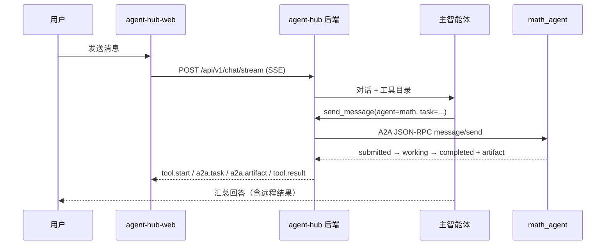

# A2A 远程智能体对话测试报告

> 日期：2026-11-12
> 测试对象：`/home/zhaodan/work/PythonProjects/a2a-agents` 中的 5 个 ADK A2A 智能体
> 被测系统：`agent-hub-web`（Vite 开发服务器，5173）+ `agent-hub` 后端（8000）+ PostgreSQL（54321）
> 测试方式：注册远程 Agent → 前端/后端对话 → 主智能体通过 `send_message` 委派 → 观察 SSE 事件、任务状态与最终回答

## 1. 结论

- 5 个远程智能体全部成功注册，健康检查均为 `healthy`，A2A JSON-RPC 调用链路可用。
- 通过主智能体的 `send_message` 工具完成 5 类任务：数学计算、天气查询、翻译、代码评审、文本研究。
- 对话测试结果：**9 个任务完成、1 个任务失败**。失败原因是 A2A 协议版本头缺失（已修复，修复后重试成功）。
- 发现 3 个对端（a2a-agents）侧问题：启动路径 bug、依赖缺失、Agent Card 格式与注册校验不兼容；以及 1 个后端客户端问题：出站请求未携带 `A2A-Version` 头。
- 远程智能体返回内容存在质量问题：翻译/代码/研究 Agent 的输出混入了推理片段且末尾不完整；翻译语言检测误判、研究工具不支持中文分词。这些是**远程智能体自身**的行为，不阻塞本项目的对话链路。

## 2. 测试环境

| 组件 | 地址 | 状态 |
|---|---|---|
| agent-hub 后端 | `http://127.0.0.1:8000` | 运行中（`/healthz` 200） |
| agent-hub-web 前端 | `http://127.0.0.1:5173` | 运行中（真实后端模式） |
| weather_agent | `http://localhost:8101` | healthy |
| translator_agent | `http://localhost:8102` | healthy |
| math_agent | `http://localhost:8103` | healthy |
| code_assistant_agent | `http://localhost:8104` | healthy |
| research_agent | `http://localhost:8105` | healthy |
| PostgreSQL | `127.0.0.1:54321` | 运行中 |

后端账号：`dev@example.com`（管理员）。远程 Agent 使用的模型：`openai/deepseek-flash`（OpenAI 兼容端点，`https://api.deepseek.com`）。

## 3. 接入适配过程

a2a-agents 项目是首次实际运行，以下问题需要处理（均在**工作区临时文件**中适配，未修改 a2a-agents 源码）：

### 3.1 启动路径不一致

- `start_agents.py` 与各 `__init__.py` 使用 `agents.<name>.agent`，但仓库根目录并没有 `agents/` 包，目录直接位于根下（`weather_agent/` 等）。
- 处理：编写 `.tmp/run_a2a_agent.py`，按文件路径直接加载 `agent.py`，再交给 uvicorn 启动，绕过错误的包导入。

### 3.2 依赖缺失

- 原 `.venv` 缺少 `litellm`（`google-adk[extensions]` 未安装）与 `sse-starlette`（`a2a-sdk[fastapi]` 未安装），启动时分别报 `ImportError: LiteLLM support requires...` 和 `ModuleNotFoundError: sse_starlette`。
- 处理：在工作区创建 `.tmp/a2a-venv`，安装 `google-adk[extensions]`、`a2a-sdk[fastapi]`、`uvicorn`；版本为 `google-adk 2.14.0`、`a2a-sdk 1.3.0`。

### 3.3 Agent Card 格式不兼容

- ADK 2.14 生成的 1.0 Card 只有 `supportedInterfaces`，没有顶层 `url` / `protocolVersion`；agent-hub 注册校验（`app/modules/a2a/card.py`）要求顶层 `url` 与 `protocolVersion`，直接注册返回 422：
  `{"error":{"code":"agent_card_invalid","message":"Agent Card 缺少 url"}}`。
- 处理：launcher 在应用启动前插入一个兼容 Card 路由，返回 1.0 接口字段 + 顶层 `url`、`protocolVersion: "1.0.0"`、`preferredTransport`；注册 URL 统一使用 `http://localhost:<port>`，与 Card 声明同源。这样注册通过，同时 JSON-RPC 仍走原生 1.0 传输。

### 3.4 A2A 版本头缺失（后端客户端）

- 首次对话失败，任务错误：
  `A2A version '0.3' is not supported by this handler. Expected version '1.0'.`
- 原因：后端 `A2aClient` 直接构造 SDK 的 `JsonRpcTransport`，没有经过 SDK `client_factory`，请求未携带 `A2A-Version` 头；服务端把缺省版本视为 0.3 并拒绝。
- 处理：通过 API 给 5 个 Agent 的 `headers` 加上 `{"A2A-Version": "1.0"}`。修复后同一任务重试成功。
- 建议：后端在 `A2aClient` 中默认发送 `A2A-Version: 1.0`（或按 Card 协商结果发送），避免依赖用户手工配置。

## 4. 注册与健康检查

| slug | 名称 | URL | 协议版本 | 健康 |
|---|---|---|---|---|
| weather | weather_agent | http://localhost:8101 | 1.0.0 | healthy |
| translator | translator_agent | http://localhost:8102 | 1.0.0 | healthy |
| math | math_agent | http://localhost:8103 | 1.0.0 | healthy |
| code-assistant | code_assistant_agent | http://localhost:8104 | 1.0.0 | healthy |
| research | research_agent | http://localhost:8105 | 1.0.0 | healthy |

注册流程：`POST /api/v1/agents/preview`（拉取并校验 Card）→ `POST /api/v1/agents`（落库）→ `POST /api/v1/agents/{id}/health`（健康检查）。5 个 Agent 均一次通过。

## 5. 对话测试矩阵

| # | Agent | 测试问题 | 任务状态 | 耗时 | 结果摘要 |
|---|---|---|---|---|---|
| 1 | math | `sqrt(144)+3^2` | completed | 8.5s | 返回 21，过程正确 |
| 2 | math（复验） | `6*7` | completed | 6.8s | 返回 42 |
| 3 | weather | 北京今天天气 | completed | 5.7s | 26°C、晴、湿度 37% |
| 4 | translator | 中译英 + 源语言 | completed | 7.2s | 译文正确；远程检测器误判为 en，Agent 自行纠正为 zh-CN |
| 5 | code-assistant | 评审 `def f(x): return x*2+1` | completed | 10.1s | 命名/类型注解/文档等建议；输出末尾被截断 |
| 6 | research | 摘要 + 关键词 + 阅读时间 | completed（3 个子任务） | 6.8s / 8.8s / 10.7s | 远程工具中文分词失效，主智能体自行处理并给出结果 |
| - | math（首次） | `sqrt(144)+3^2` | failed | 0.06s | `A2A version '0.3' is not supported`，修复版本头后重试成功 |

任务统计（后端 `/api/v1/tasks`）：**10 total，9 completed，1 failed**。

## 6. 典型调用链

以 math 委派为例，SSE 事件序列如下：



关键事件：

- `tool.start`：`tool=send_message`，`agent=math`，包含任务文本；
- `a2a.task`：`submitted → working → completed`，带 `task_id`、`a2a_task_id`、`duration_ms`；
- `a2a.artifact`：远程返回的文本 artifact；
- `tool.result`：工具结果摘要（后端按 500 字符截断）；
- `message.done`：本轮回答结束。

## 7. 发现的问题

| # | 问题 | 影响 | 建议 |
|---|---|---|---|
| 1 | a2a-agents 的 `agents.*` 包路径与目录结构不一致 | 无法按文档启动 | 修正 `__init__.py` / `start_agents.py`，或在根目录补 `agents/` 包 |
| 2 | 缺少 `litellm`、`sse-starlette` 依赖 | 启动失败 | 在 `pyproject.toml` 中加入 `google-adk[extensions]`、`a2a-sdk[fastapi]` 并 `uv sync` |
| 3 | ADK 2.14 的 1.0 Card 无顶层 `url`/`protocolVersion` | 注册 422 | 注册前补兼容字段（本项目 launcher 已做），或升级后端 Card 归一化逻辑 |
| 4 | 后端 A2aClient 未发送 `A2A-Version` 头 | 首次调用被服务端按 0.3 拒绝 | 后端默认发送 1.0 版本头 |
| 5 | 远程 Agent 输出混入推理片段、末尾不完整（translator / code-assistant / research） | 回答质量下降 | 远程 Agent 侧关闭或剥离 DeepSeek reasoning 内容，并限制输出长度 |
| 6 | translator 的语言检测把中文判成 en | 检测字段不可信 | 修正检测工具或改用专业语言识别 |
| 7 | research 的摘要/关键词/阅读时间按空格分词 | 中文文本 word_count=1，结果失真 | 支持中文分词（jieba 等） |
| 8 | `tool.result` 摘要按 500 字符截断 | 主智能体只能看到片段 | 属后端设计；完整结果可在任务详情 `result.artifact.parts` 查看（已验证 translator 完整 artifact 1425 字符） |
| 9 | WSL 在测试期间两次意外退出，Chromium 等待回复时崩溃 | 未完成对话页最终截图 | 与测试环境资源有关；建议降低并发、避免长时间 headless 浏览器，或增加 WSL 内存 |

## 8. 前端验证

- 前端以真实后端模式启动（`.env.development.local` 中 `VITE_USE_MOCK=false`），登录 `dev@example.com` 成功。
- 智能体页面（`/agents`）显示后端注册的 5 个 Agent，统计为 5 个总数、5 个健康，健康状态与协议版本正常。截图见工作区 `.tmp/screenshots/agents-page.png`（容器缺少中文字体，界面文字显示为方框，但 Agent 名称、URL、状态可辨认）。
- 前端对话页曾实际触发 math 任务并完成（任务 `94a68068`，`completed`，48s），说明前端 → 后端 → A2A 的完整链路可用；但 headless Chromium 在等待最终回复时崩溃，未截到对话页最终截图。
- 由于环境稳定性原因，未继续用浏览器做更多 UI 自动化；对话链路证据以 SSE 事件、任务记录和智能体页面截图为准。

## 9. 复现方式

临时脚本位于工作区 `.tmp/`（未纳入版本库）：

```bash
# 1. 启动 5 个远程 Agent（工作区 venv，端口 8101-8105）
bash .tmp/start_a2a_agents.sh

# 2. 注册并健康检查（使用 dev 管理员 token）
python3 .tmp/register_agents.py

# 3. 单轮对话（打印 SSE 事件与回答）
/home/zhaodan/work/PythonProjects/agent-hub/.venv/bin/python .tmp/chat_test.py \
  '请调用 send_message 工具，agent=math，任务：计算 6*7，并告诉我结果。'

# 4. 批量测试 translator / code-assistant / research
/home/zhaodan/work/PythonProjects/agent-hub/.venv/bin/python .tmp/chat_batch.py
```

前置条件：

- PostgreSQL、agent-hub 后端（8000）、agent-hub-web（5173）已启动；
- a2a-agents 目录中存在 `.env.example`（提供 `LITELLM_*` 配置），模型可用；
- 注册的 Agent 均需配置 `headers: {"A2A-Version": "1.0"}`；
- 后端环境变量 `A2A_ALLOW_LOOPBACK=true`（dev 环境默认）。

## 10. 结论与后续建议

1. 5 个远程智能体已能在本项目中完成注册、健康检查与对话委派，主智能体与 A2A 任务的 SSE 事件、任务状态、artifact 均正常。
2. 若要把这套 Agent 作为长期联调环境，建议修复 a2a-agents 的启动路径、依赖声明与 Card 兼容性，并在后端补上 `A2A-Version` 头。
3. 远程 Agent 的回答质量受推理输出与中文工具限制影响，建议逐项修复后再用于演示。
4. 下一轮可补充：流式 A2A 任务、`input_required` / `auth_required` 等待态、任务取消、审批联动、并发与超时场景。
