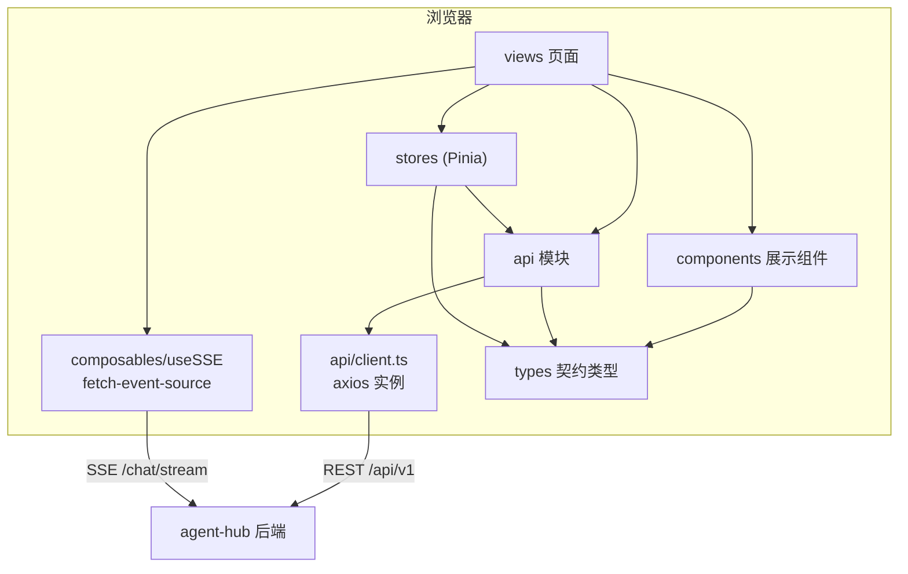
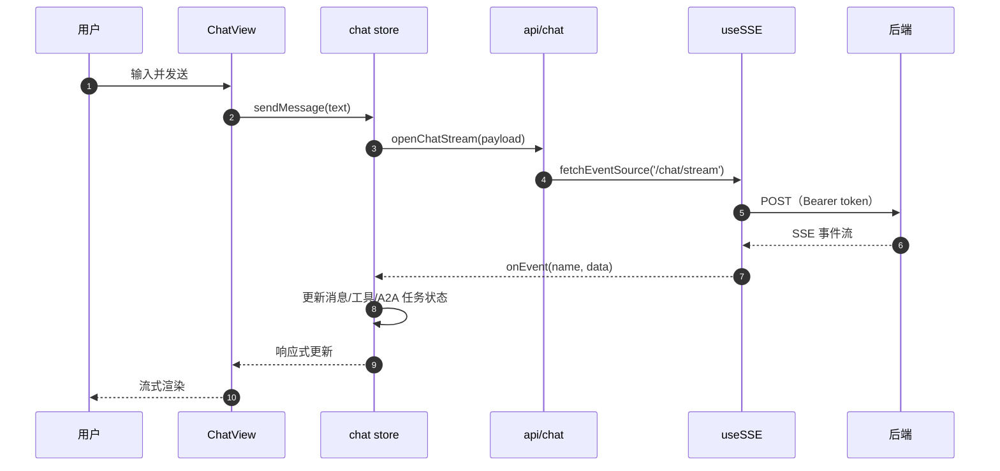

# 前端架构

- 项目：Agent Hub Web（`agent-hub-web`）
- 状态：设计稿；当前仅有 create-vue 脚手架配置，页面与请求层未实现
- 更新时间：2026-11-04

## 1. 目标

1. 提供流畅的多轮对话工作台，SSE 流式渲染回答与任务进度；
2. 让用户管理远程 A2A 智能体、知识库与审批；
3. 与后端契约解耦：类型集中在 `src/types/`，页面不直接拼 URL；
4. 保持工程化基线：TypeScript 严格模式、ESLint/Prettier、可构建、可测试（后续补 Vitest）。

## 2. 技术架构



## 3. 分层职责

> 下表是规划目标；当前仓库只有 `src/main.ts`、`src/App.vue`、`src/router/index.ts`，
> 其余目录为空占位（`.gitkeep`），尚未创建对应实现。

| 层 | 目录 | 职责 | 禁止 |
|---|---|---|---|
| 页面 | `views/` | 路由级页面、编排组件与 store | 直接写 axios/fetch |
| 展示组件 | `components/` | 纯展示与局部交互，props/emits | 直接请求接口、依赖路由 |
| 状态 | `stores/` | 跨页面共享状态与异步动作 | 直接操作 DOM |
| API | `api/` | 接口函数、参数/响应类型、SSE 封装 | 处理 UI 提示 |
| 类型 | `types/` | 与后端契约对应的类型 | 引入运行时依赖 |
| 组合式 | `composables/` | 可复用逻辑（SSE、Markdown、滚动） | 依赖具体页面 |
| 布局 | `layouts/` | 应用外壳、导航、全局出口 | 业务状态 |

约定：

- 页面只通过 store 或 `api/` 模块访问数据；
- 展示组件不 import store（除全局主题/用户外），通过 props 传入；
- 所有接口错误统一为 `ApiRequestError`，页面决定展示方式。

## 4. 关键数据流

### 4.1 对话（规划，M1）



事件处理原则：

- `message.delta` 追加到当前 assistant 消息，按帧合并（`requestAnimationFrame`）避免高频重渲染；
- `tool.*` / `a2a.*` 作为消息时间线中的「过程卡片」，不混入正文；
- `approval.required` 弹出确认卡片，用户决定后调用审批接口并继续接收同一流；
- `message.done` 结束本轮，刷新会话列表的 `last_message_at`；
- 未知事件忽略并记录 debug 日志，不中断流。

### 4.2 认证（M1）

- 登录成功：access/refresh 存 localStorage（生产可改 httpOnly cookie，需要后端配合）；
- axios 请求自动带 `Authorization: Bearer`；
- 401：清理会话并跳转登录；刷新令牌在 M1 实现（单飞锁，避免并发刷新）。

### 4.3 列表页（会话/任务/智能体）

- 进入页面拉取第一页；滚动到底部加载下一页（cursor）；
- 写操作后局部更新列表，不全量刷新；
- 空态、加载态、错误态三态必须实现。

## 5. 状态管理

| Store | 状态 | 说明 |
|---|---|---|
| `auth` | accessToken、refreshToken、user、isAuthenticated | 规划（当前未创建） |
| `chat` | 当前会话、消息时间线、流式状态、工具/任务卡片 | M1 |
| `conversations` | 列表、分页游标、筛选条件 | M1 |
| `agents` | 远程 Agent 列表、健康状态、注册表单 | M2 |
| `tasks` | A2A 任务列表、筛选、实时更新 | M2 |
| `knowledge` | 文档列表、上传队列、检索结果 | M4 |

约定：

- 使用 Setup Store（`defineStore('x', () => {...})`）；
- store 不持有组件引用与 DOM；
- 异步动作返回 Promise，错误向上抛，由页面统一提示；
- 派生数据用 `computed`，不重复存 state。

## 6. 路由与布局

| 路径 | 页面 | 布局 |
|---|---|---|
| `/chat` | `ChatView` | AppLayout |
| `/conversations` | `ConversationsView` | AppLayout |
| `/agents` | `AgentsView` | AppLayout |
| `/tasks` | `TasksView` | AppLayout |
| `/knowledge` | `KnowledgeView` | AppLayout |
| `/settings` | `SettingsView` | AppLayout |
| `/login` | `LoginView`（M1） | 独立布局 |

- 路由级懒加载（`() => import(...)`），首屏只加载布局与当前页；
- `meta.title` 驱动顶栏与 `document.title`；
- 路由守卫在 M1 加：未认证访问业务页 → `/login?redirect=...`；
- 404 重定向到 `/chat`（后续可改为 NotFound 页）。

## 7. SSE 设计

原生 `EventSource` 只支持 GET、不能带自定义 header，因此用 `@microsoft/fetch-event-source`：

```ts
await fetchEventSource('/api/v1/chat/stream', {
  method: 'POST',
  headers: {
    'Content-Type': 'application/json',
    Authorization: `Bearer ${token}`,
  },
  body: JSON.stringify(payload),
  signal: controller.signal,
  openWhenHidden: true,
  async onopen(response) {
    if (response.ok && response.headers.get('content-type')?.includes('text/event-stream')) return
    throw new Error(`SSE 连接失败: ${response.status}`)
  },
  onmessage(ev) {
    if (!ev.event || ev.event === 'ping') return
    handleEvent(ev.event, JSON.parse(ev.data))
  },
  onerror(err) {
    // 返回数字表示重试间隔；抛错则终止。业务错误应抛错，网络错误有限重试。
    throw err
  },
})
```

要点：

- `AbortController` 在组件卸载/用户停止时调用；
- 后端默认「断开不取消」；前端重连后按 `run_id` 拉最终状态；
- 断线重试最多 3 次，指数退避；`message.done` 后不重连；
- SSE 事件 `id` 可用于后续 `Last-Event-ID` 断点续传（后端 M6 支持）。

## 8. 样式方案

- 全局 CSS 变量（`src/styles/main.css`）定义色板、圆角、字体；
- Element Plus 通过 `--el-color-primary` 等变量覆盖主题；
- 页面样式用 `<style scoped>`，避免全局污染；
- 布局：左侧固定侧边栏 + 右侧自适应内容区；窄屏侧边栏收窄为图标；
- 后续视觉升级时，优先改 CSS 变量与布局组件，不散落改页面。

## 9. 错误、加载与空态

| 状态 | 表现 |
|---|---|
| 加载 | 骨架屏/`el-skeleton`，避免布局跳动 |
| 空态 | 图标 + 一句说明 + 主操作按钮 |
| 错误 | 行内错误条 + 重试按钮；全局 toast 只用于一次性失败 |
| 流式错误 | 消息气泡内显示错误卡片，保留已生成内容 |
| 断线 | 顶部提示「连接断开，正在重试」 |

## 10. 性能

- 路由懒加载；重型依赖（Markdown、代码高亮）按需 import；
- 长会话消息列表用虚拟滚动（`el-virtual-list` 或自研，M4 评估）；
- SSE 增量按帧合并，避免每个 token 触发一次完整重渲染；
- Markdown 渲染做缓存（按 message_id + content hash）；
- 图片/附件走缩略图与懒加载。

## 11. 安全

| 风险 | 措施 |
|---|---|
| XSS | Markdown 渲染必须经过 DOMPurify；禁止 `v-html` 直接渲染未清洗内容 |
| Token 泄露 | 不在日志/URL 中输出 token；生产评估 httpOnly cookie |
| CSRF | Bearer token 方案天然免疫；若改 cookie 需加 CSRF token |
| 恶意链接 | 外链 `rel="noopener noreferrer"`，域名白名单提示 |
| 远程内容 | A2A/工具返回内容按不可信渲染，禁止自动执行 |

## 12. 构建与部署

```bash
pnpm build       # 产出 dist/
pnpm preview     # 本地预览生产构建
```

- 静态资源部署到 Nginx/CDN；
- Nginx 需配置 `/api` 与 `/a2a` 反向代理，SSE 关闭缓冲：

```nginx
location /api/ {
    proxy_pass http://agent-hub:8000;
    proxy_http_version 1.1;
    proxy_set_header Connection '';
    proxy_buffering off;
    proxy_read_timeout 3600s;
}
```

- 环境变量只有 `VITE_` 前缀会打进客户端，禁止放密钥。
