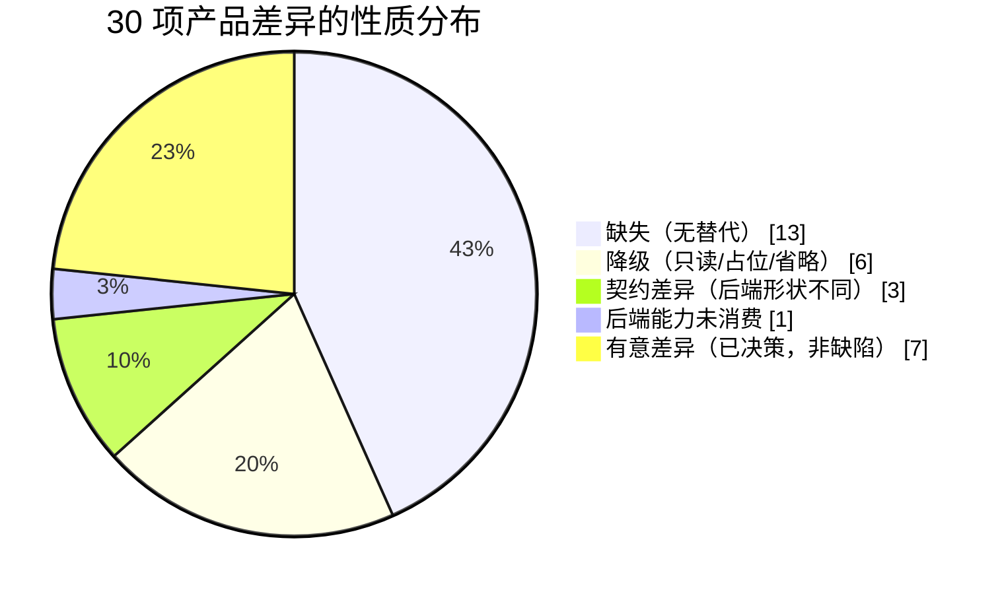

# Agent Hub 前后端 × 需求/原型差异统计报告

- 日期：2026-11-13
- 范围：前端 `agent-hub-web`（`src/`、路由、API 层、测试与文档）；后端 `agent-hub`（OpenAPI、路由、schema、模型）
- 基线：v7/v8 定稿原型（2026-11-08）、[页面规划](../pages.md)、[前端路线图](../roadmap.md)、[后端交接包](README.md)（2026-11-08 契约提案）
- 方法：静态代码/路由/OpenAPI 核对 + 文档逐条对照 + 单测复跑；**mock 通过不计入“已联调”**
- 附件：[差异台账 CSV](assets/2026-11-13-gap-ledger.csv)
- 整改方案：[差异整改方案](../superpowers/plans/2026-11-13-gap-remediation.md)（2026-11-13；2026-11-16 决策选 B 路径）
- 后续：[整改方案](../superpowers/plans/2026-11-13-gap-remediation.md)、[治理决策 ADR](../superpowers/specs/2026-11-16-governance-decision.md)、[接受清单](2026-11-13-accepted-deviations.md)、[整改报告 2026-11-16-gap-remediation-report.md](2026-11-16-gap-remediation-report.md)、[30 项关闭台账 CSV](assets/2026-11-16-gap-closure.csv)、[文档修订记录](2026-11-16-doc-sync.md)
- 证据更新：[M8 冒烟留档](2026-11-16-m8-smoke.md)（`smoke:m8` 69/69，2026-11-16）已关闭 §8 V1；V2–V4 仍待取证；正文判定保留为 2026-11-13 历史结论。

> **一句话结论**：页面与接口“接得上”（原型页面 13/13、业务端点 107/107、0 幽灵调用），但功能与需求/原型“对不齐”的地方仍有 **30 项**，其中 **P1 7 项、6 项集中在管理台**；“像素级对齐”是呈现层结论，不等于功能对齐。

---

## 0. 一页结论

### 0.1 关键数字

| 维度 | 数值 | 说明 |
|---|---:|---|
| 原型页面覆盖 | **13/13** | v7 工作台 + v7-pages 5 页 + v8 管理台 7 页，均有对应路由/视图 |
| 前端路由记录 | 21 条 | 含登录/注册、业务页、管理台 7 页、`/admin/forbidden`、404、根重定向 |
| 后端 OpenAPI | 78 路径 / 109 操作 | 以 `agent-hub/docs/openapi.json` 为准（含 `/healthz`、`/readyz`） |
| 前端业务端点覆盖 | **107/107** | 2 个探针端点不面向 UI；**0 个前端调用在后端不存在** |
| 需求章节 | 5 完全对齐 / 7 有差异 | [pages.md](../pages.md) 12 个功能章节 |
| 产品差异项 | **30** | 缺失 13 / 降级 6 / 契约差异 3 / 后端能力未消费 1 / 有意差异 7 |
| 严重度 | **P1 7 / P2 16 / P3 7** | 无 P0（无阻断主链路的问题） |
| 文档偏差 | 5 处 | 见 §7，含根 README、原型索引、路线图口径 |
| 验证缺口 | 4 项 | 见 §8，主要是 M8 真实联调留档与真实 LLM 证据 |
| 单测复跑 | **475/475 通过** | 80 个文件，2026-11-13 00:52 本机实测 |

### 0.2 五条判断

1. **主链路质量好于“差异数”给人的印象**：对话、会话、任务、知识库、审批、工作流、M8 管理台七页都能跑通；后端 M0–M9（M3 取消）已交付，前端 API 层没有“调用不存在的端点”。
2. **差异重心在管理台（11/30）**：v8 原型里的 RBAC、菜单、字典、平台运维设置四块后端没有建表/接口，导致 3 页只读、1 页信息架构被替换、2 列/2 个操作缺数据。
3. **对话页最大单点缺口是运行轨迹抽屉**：原型有“执行时间线 + 图例 + 类型筛选 + 搜索 + 回合折叠 + 事件展开”6 类交互，实现只保留了 3 段列表 + 服务端事件表。
4. **“后端已支持、前端没用”的能力真实存在**：审批决定的 `note` / `decision_note`（备注）已在后端 schema 与前端类型里，但审批卡没有输入与展示。
5. **文档状态明显滞后于实现**：根 README、原型索引、交接包仍写“M8/M9 待后端/未开始”，路线图单测口径在 398/402/475 之间打架；后来者会误判项目进度。

### 0.3 差异性质分布



> 另有 **5 处文档偏差** 与 **4 项验证缺口** 单独统计，不混入上述 30 项。

---

## 1. 审计口径

### 1.1 对照基线

| 维度 | 采用的基线 | 说明 |
|---|---|---|
| 需求设计 | [docs/pages.md](../pages.md)、[docs/roadmap.md](../roadmap.md) | pages.md 是功能目标规格；roadmap 定里程碑与验收口径 |
| 原型设计 | `ui-v7.html`、`ui-v7-pages.html`、`ui-v8-admin.html` | 2026-11-08 定稿评审基线；v1–v6 仅作追溯，不计入 |
| 后端契约 | `agent-hub/docs/openapi.json`、`docs/api.md`、M7/M8/M9 handoff | 以已实装 OpenAPI 为准，不用设计稿臆测 |
| 实现 | `src/`、`agent-hub/app/` | 代码为准，文档只作线索 |

### 1.2 统计单元与状态定义

- **统计单元**：一条可独立验收/修复的**产品行为差异**；同一根因在不同页面只计一次，纯视觉细节不计（像素报告已记录 7 类有意偏离）。
- **状态**：
  - `缺失`：原型/需求有，实现没有，且无等价替代；
  - `降级`：只读、占位、省略或加提示，能力被明确收缩；
  - `契约差异`：实现了，但数据形状/步骤模型与原型/需求不同；
  - `后端能力未消费`：后端已提供，前端未使用；
  - `有意差异`：经决策接受，**不是缺陷**，不应按 bug 修。
- **严重度**：
  - `P1`：影响管理闭环、信任（审计数据）或原型核心交互；
  - `P2`：影响效率/完整性，但有替代路径；
  - `P3`：文案、装饰、边缘路径。

### 1.3 证据等级

| 等级 | 含义 | 本报告用法 |
|---|---|---|
| E1 | 本次代码/接口/测试实测 | 路由清单、OpenAPI 对账、475 单测复跑 |
| E2 | 交付报告中的实测记录 | 42 E2E、axe 0、smoke:m7/m9 数字 |
| E3 | 文档声明但本次未复验 | smoke:m8、真实 LLM 长流、后端 885 测试 |

---

## 2. 总览统计

### 2.1 按模块 × 严重度

| 模块 | P1 | P2 | P3 | 合计 | 占比 | 主要问题 |
|---|---:|---:|---:|---:|---:|---|
| 对话 | 1 | 5 | 2 | **8** | 26.7% | 运行轨迹抽屉、重新生成、审批备注、候选项截断 |
| 管理台 | 6 | 4 | 1 | **11** | 36.7% | RBAC/菜单/字典/平台设置无契约、审计 IP/结果、运行量图 |
| 工作流 | 0 | 2 | 2 | **4** | 13.3% | 步骤模型 6→5、运行统计、画布、系统模板直达 |
| 设置 | 0 | 2 | 1 | **3** | 10.0% | 偏好不同步、语言只读、A2A 分区移除 |
| 知识库 | 0 | 2 | 0 | **2** | 6.7% | 单文档重建、分类目录 |
| 智能体 | 0 | 1 | 0 | **1** | 3.3% | 注册后不可编辑鉴权 |
| 全局 | 0 | 0 | 1 | **1** | 3.3% | A2A 入站取消（有意） |
| **合计** | **7** | **16** | **7** | **30** | 100% | — |

### 2.2 按根因

| 根因 | 数量 | 占比 | 说明 |
|---|---:|---:|---|
| 后端契约缺口 | **15** | 50.0% | 无表/无端点/字段不回显，前端只能只读或省略 |
| 前端待办 | **6** | 20.0% | 后端已具备或纯前端可做（轨迹抽屉、审批备注、智能体编辑、候选分页等） |
| 设计决策 | **7** | 23.3% | 逐字续流、多实例 SSE、删除审批页、A2A 分区、画布、演示徽标、A2A 入站 |
| 设计变更 | **1** | 3.3% | 工作流步骤模型 6 类 → 5 类 |
| 产品决策 | **1** | 3.3% | 多语言未排期 |

> 结论：**一半差异的根因在后端契约**，但其中 6 项（轨迹抽屉、审批备注、智能体编辑、候选项分页、系统模板守卫、停用模板提示）是前端自己就能收口的，不应等后端。

### 2.3 与“像素级对齐”的关系

2026-11-12 的像素级对齐解决的是**布局骨架、组件结构、字号/间距/层级**；本报告核对的是**功能、契约、信息架构**。两者不冲突，但需要区分口径：

- 像素报告 §4 已声明 7 类“有意偏离”（数据缺口、管理台入口、装饰、功能增强、对比度、Element Plus 外壳、演示态）；
- 本报告认为 **“运行轨迹抽屉交互”“系统设置 IA”“审计 IP/结果”** 三项不能只按视觉差异处理：前两项涉及交互/信息架构，后一项是可见的数据缺失，均已按功能差异计入台账。

---

## 3. 需求设计 vs 实现（按 `pages.md` 章节）

`pages.md` 共 12 个功能章节：**5 个完全对齐，7 个至少有一项差异**。章节之间存在同一差异的交叉引用（如审批备注同时属于 §3 与 §7.1），因此下表“关联差异”不与 30 项求和。

| 章节 | 需求要点 | 结论 | 关联差异 |
|---|---|---|---|
| §2 登录/注册 | 表单校验、redirect、路由守卫、401 | ✅ 完全对齐 | — |
| §3 对话 | SSE、乐观更新、停止、工具/A2A/审批卡、续流、模型/推理 | ⚠️ 有差异 | D1–D8 |
| §4 会话列表 | 搜索 `q`、分组、重命名/归档/删除、待审批点 | ✅ 完全对齐 | — |
| §5 智能体 | 列表/两段式注册/详情/健康/启停/删除、RBAC | ⚠️ 有差异 | A1 |
| §6 任务 | 8 状态、筛选、详情、轮询、取消/补充/授权/拒绝、深链 | ✅ 完全对齐 | — |
| §7 知识库 | 列表/上传/轮询/检索调试/重建/引用 | ⚠️ 有差异 | K1、K2 |
| §7.1 审批 | 对话内唯一入口、多卡、倒计时、遮罩、409/超时语义 | ⚠️ 有差异 | D3（备注） |
| §8 设置 | 账号/个人能力/模型/界面/安全与审计/关于 | ⚠️ 有差异 | S1–S3 |
| §8.1 管理控制台 | 七页、用户规则、系统设置写操作、审计 | ⚠️ 有差异 | M1–M10、A2 |
| §8.2 工作流 | 列表/线性编辑器/运行历史/对话接入/门控 | ⚠️ 有差异 | W1–W4 |
| §9 响应式与可访问性 | 三档断点、键盘、对比度、axe、虚拟滚动 | ✅ 完全对齐 | — |
| §11 个人能力层 | 指令/记忆/技能/MCP 四区块、门控、互斥 | ✅ 完全对齐 | — |

**判定依据摘要**

- §2/§4/§6/§9/§11：路由、组件、接口与测试均在位（如 `ConversationSidebar` 的 `q` 搜索与分组、`TaskDetailDrawer` 的请求/结果/错误/授权/时间线、`vList` 虚拟滚动）。
- §3：主链路完整，但运行轨迹抽屉与原型差距最大；`重新生成` 至今无后端契约（`pages.md:109`）。
- §5：注册/健康/启停/删除/RBAC 完整，但注册后不能改名称/鉴权/headers（后端 `AgentUpdateRequest` 已支持）。
- §7：核心链路已联调；两个“后端没有的端点”用 retry 与文档聚合替代（`pages.md:165`）。
- §8.1：七页都在，但 v8 的“平台运维”信息架构没有对应契约，详见 §4.2 与 §5.2。

---

## 4. 原型设计 vs 实现

### 4.1 v7 工作台与业务五页

| 原型页面 | 实现映射 | 结论 | 缺口 |
|---|---|---|---|
| 对话工作台 | `ChatView` + `ProcessTimeline` + `RunTracePanel/Drawer` + `ChatComposer` | ⚠️ 大体对齐，轨迹抽屉简化 | D1、D2、D3 |
| 工作流 | `WorkflowsView` / `WorkflowsEditorView` / `WorkflowsRunsView` | ⚠️ 结构对齐，模型不同 | W1–W4 |
| 智能体 | `AgentsView` + `AgentDetailDrawer` + `AgentRegisterDialog` | ⚠️ 基本对齐 | A1 |
| 任务 | `TasksView` + `TaskDetailDrawer` | ✅ 对齐 | — |
| 知识库 | `KnowledgeView` + `SearchDebugPanel` + `DocumentDetailDrawer` | ⚠️ 基本对齐 | K1、K2 |
| 设置 | `SettingsView`（6 分区） | ⚠️ 基本对齐 | S1–S3 |

**原型元素级差距（v7）**

- 运行轨迹抽屉原型包含：执行时间线总览条、6 色图例、事件类型筛选（消息/工具/A2A/MCP/审批）、搜索框、`折叠回合`、可展开事件行（`ui-v7.html:2935-2995`）；实现只有“执行轨道 / 引用来源 / 本轮智能体 / 服务端事件表”（`RunTracePanel.vue:216-330`），**6 类交互全部缺失**。
- 原型设置页含 A2A 分区（入站端点、JWT 鉴权）；实现按 2026-11-10 决策整块移除，属**有意差异**。
- 原型语言选择为可切换（简中/English）；实现为禁用下拉，只有 zh-CN（`SettingsView.vue:337-340`）。

### 4.2 v8 管理台七页

| 原型页面 | 实现 | 结论 | 缺口 |
|---|---|---|---|
| 概览 | `AdminOverviewView` | ⚠️ 有替代，缺主图 | M1 |
| 用户管理 | `AdminUsersView` | ⚠️ 缺列/缺操作 | M2、M3 |
| 角色与权限 | `AdminRolesView` | ⚠️ 只读 | M4 |
| 菜单管理 | `AdminMenusView` | ⚠️ 只读镜像 | M5 |
| 字典管理 | `AdminDictionariesView` | ⚠️ 只读 | M6 |
| 审计日志 | `AdminAuditView` | ⚠️ 两列无数据 | M7 |
| 系统设置 | `AdminSettingsView` | ⚠️ 信息架构被替换 | M8 |
| 全局壳（顶栏/入口） | `AdminLayout` + 账号菜单 | ⚠️ 少搜索/通知 | M9、M10 |

**原型元素级差距（v8）**

| 原型元素 | 实现现状 | 性质 |
|---|---|---|
| 概览「运行量」近 7 天柱状图 + 24h/7d/30d 切换 | 整块省略（注释明确写“后端无契约”） | 缺失 |
| 用户表「会话」列 | 表头改为「创建于」，无会话数 | 缺失 |
| 「邀请用户」「导出用户」 | 无入口（导出可纯前端实现） | 缺失 |
| 角色页 5 个演示角色 + 权限矩阵编辑/保存 | 2 个内置角色 + 只读矩阵 | 降级 |
| 菜单页新建/编辑/删除（16 项菜单） | 前端路由只读镜像 | 降级 |
| 字典页 6 类字典 + 字典项 CRUD | 前端内置枚举只读 | 降级 |
| 审计表「IP」「结果」 | 表头在，单元格恒为 `—`（接口无字段） | 缺失 |
| 系统设置 7 分区（基础信息/认证与安全/A2A 与智能体/模型与配额/数据保留/功能开关/危险操作，约 30+ 字段） | 5 个能力分区（平台指令/系统技能/系统 MCP/全局 Agent/平台密钥） | 缺失 + IA 替换 |
| 顶栏全局搜索、通知铃铛、`原型演示` 徽标 | 无（主题切换与头像保留） | 缺失/装饰 |

> 管理台 7 页中 **3 页只读（43%）**、**1 页主图缺失**、**1 页信息架构被替换**；这是“v8 全量”表述与实际交付之间最大的口径落差。

---

## 5. 差异台账（30 项）

> 完整字段（含建议）见 [CSV 台账](assets/2026-11-13-gap-ledger.csv)；下表保留判定所需的最小证据。

### 5.1 对话（8 项）

| 编号 | 差异项 | 性质 | 严重度 | 根因 | 证据 |
|---|---|---|---|---|---|
| D1 | 运行轨迹抽屉缺时间线总览/图例/筛选/搜索/回合折叠/事件展开 | 缺失 | **P1** | 前端待办 | `RunTracePanel.vue:216-330` vs `ui-v7.html:2935-2995` |
| D2 | 消息重新生成 | 缺失 | P2 | 后端契约 | `pages.md:109`；后端无 regenerate |
| D3 | 审批备注输入与 `decision_note` 展示 | 未消费 | P2 | 前端待办 | 后端 `approvals/schemas.py:50-52`；前端类型有、审批卡无输入 |
| D4 | 工作流候选只取第一页（默认 20 条） | 降级 | P2 | 前端待办 | `ChatView.vue:128-135`；M9 报告 §6 |
| D5 | 停用模板经 query 预选被静默忽略 | 缺失 | P3 | 前端待办 | `ChatView.vue:137-145`；M9 报告 §6 |
| D6 | 断线窗口未落库 `message.delta` 不补齐 | 有意差异 | P2 | 设计决策 | `pages.md:98`；M6 明确不做逐字续流 |
| D7 | 多实例 SSE 不支持 | 有意差异 | P2 | 设计决策 | `roadmap.md:283` |
| D8 | 独立审批页 `/approvals` 删除 | 有意差异 | P3 | 设计决策 | `pages.md:167-181`；v7 原型亦为对话内审批 |

**说明**

- D1 是对话页唯一的 P1：用户点“查看运行事件”后，看到的是三段式摘要 + 服务端事件表，而不是原型的“可筛选、可搜索、可折叠、可展开”的排障视图。对“过程可查”的产品定位影响最大。
- D3 不是需求缺口（`pages.md` 明说“当前不含备注输入”），而是**后端能力闲置**：`ApprovalDecisionRequest.note` 与 `Approval.decision_note` 都已存在，前端没有入口，已决审批也不显示备注。
- D6/D7 是已声明的边界，不应作为 bug 修；D7 在扩容前必须重新评估（粘性会话/Redis 事件总线）。

### 5.2 管理台（11 项）

| 编号 | 差异项 | 性质 | 严重度 | 根因 | 证据 |
|---|---|---|---|---|---|
| M1 | 概览无运行量柱状图/时间范围 | 缺失 | **P1** | 后端契约 | `AdminOverviewView.vue:16-20`；原型 `ui-v8-admin.html:1083-1088` |
| M2 | 用户页无「会话数」列 | 缺失 | P2 | 后端契约 | `AdminUserOut` 无 `conversation_count`（`admin/schemas.py:22-32`） |
| M3 | 用户页无「邀请/导出」 | 缺失 | P2 | 后端契约 | 原型 `ui-v8-admin.html:1161-1162`；`AdminUsersView` 无入口 |
| M4 | 角色权限只读（2 角色，无新建/编辑） | 降级 | **P1** | 后端契约 | `AdminRolesView.vue:11-12,128` |
| M5 | 菜单管理只读镜像 | 降级 | **P1** | 后端契约 | `AdminMenusView.vue:9-10,122` |
| M6 | 字典管理只读 | 降级 | **P1** | 后端契约 | `AdminDictionariesView.vue:28-29,229` |
| M7 | 审计「IP/结果」恒为 `—` | 缺失 | **P1** | 后端契约 | `AdminAuditView.vue:539-540,565-566`；`AuditLogOut` 无字段 |
| M8 | 系统设置缺原型 7 分区 | 缺失 | **P1** | 后端契约 | `AdminSettingsView.vue:30-36`（仅 5 个能力分区） |
| M9 | 顶栏无全局搜索/通知铃铛 | 缺失 | P2 | 后端契约 | `AdminLayout.vue:225-252` vs `ui-v8-admin.html:1015-1035` |
| M10 | `原型演示` 徽标等装饰未实现 | 有意差异 | P3 | 设计决策 | 像素报告 §4.3 |
| A2 | 全局 Agent 的 `headers` 不可编辑 | 降级 | P2 | 后端契约 | `AdminAgentCard.vue:439`；响应不回显明文 |

**说明**

- M4/M5/M6 三页只读是 **M8 立项时就写明的范围**（“无契约三页只读 + 明确提示”），不是偷偷缩水；但 v8 原型把它们画成可编辑，交付说明又用了“全量七页”，对外表述需要修正为“**七页在位，其中三页只读**”。
- M7 的根因很具体：`audit_logs` 表已有 `ip` 列（`app/db/models/audit.py:39`），但 `AuditLogOut` 没有输出，前端只能把两列写成 `—`。这是**低成本的信任修复**（后端加字段 + 前端渲染）。
- M8 不是简单“少 7 个面板”：原型是**平台运维**（环境/认证/配额/保留/开关/危险操作），实现是**能力配置**（指令/技能/MCP/Agent/密钥）。两者 IA 不同，需先决定目标形态，再谈补齐。
- M1 的“系统状态/最近管理操作/待处理”三块已用真实数据聚合，属于超出原型的增强；缺的只有按日运行量序列。

### 5.3 设置 / 智能体 / 知识库 / 工作流 / 全局（11 项）

| 编号 | 模块 | 差异项 | 性质 | 严重度 | 根因 | 证据 |
|---|---|---|---|---|---|---|
| S1 | 设置 | 语言切换只读 | 降级 | P2 | 产品决策 | `SettingsView.vue:337-340` |
| S2 | 设置 | 主题/密度偏好仅 localStorage | 缺失 | P2 | 后端契约 | `pages.md:192`；`roadmap.md:281` |
| S3 | 设置 | A2A 分区移除 | 有意差异 | P3 | 设计决策 | `roadmap.md:91-98` |
| A1 | 智能体 | 注册后不可编辑名称/鉴权/headers | 缺失 | P2 | 前端待办 | 后端 `AgentUpdateRequest` 支持；前端仅用 `enabled`（`AgentDetailDrawer.vue:148`） |
| K1 | 知识库 | 无单文档重建，retry 替代 | 契约差异 | P2 | 后端契约 | `pages.md:165`；`roadmap.md:115` |
| K2 | 知识库 | 无分类目录端点，候选由前 100 篇聚合 | 契约差异 | P2 | 后端契约 | `capabilities.ts:63-77`；`pages.md:165` |
| W1 | 工作流 | 步骤模型 6 类 → 5 类（技能/MCP 取消，新增 answer） | 契约差异 | P2 | 设计变更 | `types/workflow.ts:9-16` vs `ui-v7-pages.html:3145-3154` |
| W2 | 工作流 | 卡片无运行次数/最近运行 | 缺失 | P2 | 后端契约 | `WorkflowsView.vue`；像素报告 §4.1 |
| W3 | 工作流 | 无拖拽画布 | 有意差异 | P3 | 设计决策 | `roadmap.md:280` |
| W4 | 工作流 | 系统模板直达可改表单、保存才 404 | 缺失 | P3 | 前端待办 | M9 报告 §6 |
| G1 | 全局 | A2A 入站取消 | 有意差异 | P3 | 设计决策 | `roadmap.md:91-98` |

**说明**

- W1 是**产品模型变化**，不只是 UI：原型可把“技能”“MCP”作为独立步骤，后端 M9 五类步骤里没有它们，技能/MCP 只能通过 `tool` 步骤或对话上下文承载。需要产品确认这是最终形态，并在文档中显式写“技能/MCP 由工具步骤承载”。
- K1/K2 都已用替代方案兜住（retry、文档聚合），但替代方案有语义差：retry 不是“重建”，文档聚合只覆盖前 100 篇，且分类为空串时显示“未分类”。
- S1 是多语言未排期，不是缺陷；但原型有可切换下拉，评审时容易被当成“退化”。

---

## 6. 后端契约缺口（根因清单）

后端 M0–M9 已交付（M3 取消），OpenAPI **78 路径 / 109 操作**；前端 API 层覆盖 **107 个业务操作（100%）**，`/healthz`、`/readyz` 两个探针不面向 UI，**0 个幽灵调用**。以下 16 项是“原型/需求要、后端没有或不回显”的根因，表中“影响”列为受影响差异编号。

| 编号 | 缺口 | 影响 | 当前事实 | 建议 |
|---|---|---|---|---|
| B1 | RBAC 角色/权限表与 API | M4 | 仅 `users.role ∈ {user, admin}`，无 roles/permissions | 立项或正式缩范围 |
| B2 | 菜单表与 API | M5 | 前端路由只读镜像 | 与 B1 同批 |
| B3 | 字典表与 API | M6 | 前端内置枚举 | 与 B1 同批 |
| B4 | 用户 `conversation_count` | M2 | `AdminUserOut` 无字段 | 列表查询加聚合 |
| B5 | 用户邀请/导出 | M3 | 无端点 | 导出可前端；邀请需后端 |
| B6 | 按日运行量聚合 | M1 | `/admin/overview` 只有累计计数 | 加 `runs_by_day` |
| B7 | 审计 `ip` / `result` 输出 | M7 | 表有 `ip`，`AuditLogOut` 不返回；无 result | 加字段（低成本） |
| B8 | 平台运维设置（7 分区） | M8 | 仅能力配置 5 端点组 | 先定目标形态 |
| B9 | 用户偏好同步 | S2 | 无 preferences 端点 | 与主题/密度一起设计 |
| B10 | 消息重新生成 | D2 | 无端点 | 立项或删需求 |
| B11 | 知识库分类目录 | K2/D4 | 无 categories 端点 | 加目录端点或限制候选提示 |
| B12 | 单文档重建 | K1 | 只有 `/retry` | 加 rebuild one 或改名 |
| B13 | 工作流运行统计 | W2 | 只有 `/runs` 明细分页 | 加聚合字段 |
| B14 | 通知/管理台全局搜索 | M9 | 无通知端点；搜索无后端索引 | 搜索可前端；通知需立项 |
| B15 | 全局 Agent `headers` 回显 | A2 | 响应不回显明文 | 返回脱敏 headers |
| B16 | 工作流技能/MCP 步骤 | W1 | 五类步骤无 skill/MCP | 确认产品口径并写文档 |

**契约健康度**

| 指标 | 结果 |
|---|---:|
| OpenAPI 路径 / 操作 | 78 / 109 |
| 前端消费的业务操作 | 107 / 107（100%） |
| 前端调用但后端不存在 | 0 |
| 管理台端点 | 15 路径 / 20 操作，全部消费 |
| 工作流端点 | 7 操作，全部消费 |
| 未消费端点 | `/healthz`、`/readyz`（探针，合理） |

> 这说明“前后端接不上”不是当前的主要矛盾；**主要矛盾是原型里的平台治理能力没有后端承载**。

### 6.1 后端不是“没做完”，而是“原型假设的治理层没进里程碑”

- 后端按**自身路线图** M0–M9（M3 取消）已交付，M8/M9 的交付报告、OpenAPI 与代码能对上；缺的是 v8 原型假设的**平台治理层**：RBAC（原型 5 角色）、菜单、字典、认证策略、配额、数据保留、功能开关、危险操作。
- 这些能力在 v8 原型里是“可编辑”的完整后台，但在后端路线图里从未立项：M8 的范围只有用户/系统项/概览，M9 只有工作流。
- 因此统计口径应写成：**后端里程碑完成度 100%（M0–M9），但 v8 治理域覆盖不足**；不能反过来说“后端 M8 没做完”。
- 同理，工作流步骤模型 6→5 是 M9 契约的**主动变更**（`docs/roadmap.md:208` 已写“五类步骤”），不是遗漏，但需要产品确认并在页面上解释“技能/MCP 由工具步骤承载”。

---

## 7. 文档与口径偏差（5 处）

> 本节记录 **2026-11-13 审计时**的文档现状；Doc1–Doc5 已于 **2026-11-16** 按 B 路径修正，现状见[文档修订记录](2026-11-16-doc-sync.md)。下文“现状描述”列保留为历史证据，不代表当前口径；30 项差异判定与本节结论均未改写。

文档偏差会直接误导排期与验收，建议随本次报告一并修正。

| 编号 | 位置 | 现状描述 | 应改为 |
|---|---|---|---|
| Doc1 | `README.md:7,22,120,144-145,180` | 仍写“M0–M7 已完成、M8/M9 待后端”，M8/M9 复选框未勾，后端状态写“M8/M9 已立项未开始” | M0–M9 已完成（M3 取消）；M8 七页在位、三页只读；M9 已交付 |
| Doc2 | `docs/prototypes/README.md:18` | “后端 M0–M6 已完成；M7/M8/M9 已立项未开始” | M7/M8/M9 已交付；M8 三页只读、M9 五类步骤 |
| Doc3 | `docs/roadmap.md:8,36,204` | 同一 M8 出现 398 / 402 单测，M9 又写 475 | 统一为“当前 475 单测”；如需保留历史，注明 398/402 各自的统计时点与口径 |
| Doc4 | `docs/handoff/README.md:18` | “当前 M0–M7 已完成，M8/M9 已立项” | 同 Doc1 |
| Doc5 | `src/components/chat/MessageBubble.vue:165` | tooltip 仍写“受控下载端点将在 M1.5 提供” | 端点已上线，改为“下载附件” |

> 另：`docs/prototypes/README.md:32-36` 仍把 M7–M9 写成“后续承接”，属同一类滞后，并入 Doc2。

---

## 8. 验证证据缺口（4 项）

### 8.1 缺口

| 编号 | 缺口 | 影响 | 现状 |
|---|---|---|---|
| V1 | `smoke:m8` 未在真实后端留档 | 管理台写操作、403/422/409 语义只有单测/mock 证据 | 脚本 `scripts/smoke-m8-backend.mjs` 已就位；路线图仍标“待联调”；本次后端 8000 未启动（`/healthz` 000） |
| V2 | E2E 只跑 mock 构建 | 真实 SSE/权限/网络错误路径未被浏览器级覆盖 | 路线图 §6 已声明；真实链路靠 `smoke:real`/`test:real` |
| V3 | 真实 LLM/embedding 证据缺失 | M4 入库、M7 长流、M9 部分 `workflow.step` 依赖 key | M4/M7 报告已注明“环境限制”；M9 本机 key 可用时曾通过 |
| V4 | M9 审批恢复链路未在 smoke 断言 | `approval.required → 批准 → run.resumed → workflow.step(ok)` 只有后端保证 | M9 报告 §6/§7 已列为待办 |

### 8.2 已有证据（本次复验/交付报告）

| 检查 | 结果 | 证据等级 |
|---|---|---|
| `pnpm test` | **475 passed / 80 files**（2026-11-13 00:52 复跑） | E1 |
| `pnpm type-check` / `pnpm lint` | 交付报告称通过 | E2 |
| `pnpm e2e` | 42 passed + 1 skipped（交付报告） | E2 |
| axe（critical/serious） | 0 违规（交付报告） | E2 |
| `smoke:m7` / `smoke:m9` | 48 项 / 67 项真实后端通过（交付报告） | E2 |
| 后端回归 | 885 passed / 1 skipped（后端 roadmap，2026-11-12） | E3 |

---

## 9. 优先级与行动建议

### 9.1 P1（建议 2–3 周内决策/启动）

| # | 行动 | 依赖 | 规模 | 验收 |
|---|---|---|---|---|
| 1 | **管理台目标形态决策**：RBAC/菜单/字典/平台设置是“立项补齐”还是“正式缩范围” | 产品 + 后端 | L | 文档与 v8 表述一致；三页只读不再被当缺陷 |
| 2 | **补齐运行轨迹抽屉**：时间线总览、图例、筛选、搜索、回合折叠、事件行展开 | 无（纯前端） | M | 与 `ui-v7.html` 逐项对照通过 |
| 3 | **审计 IP/结果**：后端 `AuditLogOut` 加 `ip`/`result`，前端渲染 | 后端 S | S | 真实数据非 `—` |
| 4 | **概览运行量**：后端加按日聚合，前端补柱状图与时间范围 | 后端 M | M | 近 7 天曲线与审计/运行表对得上 |
| 5 | **文档口径修正**：Doc1–Doc5 | 无 | S | 根 README / 原型索引 / 交接包 / 路线图口径一致 |

### 9.2 P2（按价值排序，可并行）

1. **审批备注**（D3，前端 S）：输入框 + `decision_note` 展示，后端零改动。
2. **智能体编辑**（A1，前端 M）：名称/鉴权引用/headers 编辑抽屉，复用注册表单。
3. **审计导出/用户导出**（M3 的一半，前端 S）：CSV 导出当前页/筛选结果。
4. **用户会话数**（M2，后端 S）：列表聚合字段。
5. **工作流运行统计**（W2，后端 S + 前端 S）。
6. **偏好同步**（S2，后端 M + 前端 S）：主题/密度/语言偏好入 `user_settings`。
7. **知识库分类目录 / 单文档重建**（B11/B12，后端 M）。
8. **消息重新生成**（D2，后端 M）：先冻结契约再排期。
9. **工作流候选分页**（D4，前端 S）：列表页拉全量或候选内搜索。
10. **顶栏搜索**（M9 的一半，前端 M）：路由/菜单/用户本地检索；通知需 B14。

### 9.3 P3（择机）

- 系统模板编辑 URL 守卫（W4，前端 S）；
- 停用模板预选提示（D5，前端 S）；
- 多语言（S1，L，需产品立项）；
- 拖拽画布（W3，L，F3 候选）；
- 通知铃铛/邀请用户（B5/B14）；
- 演示徽标等装饰（M10，不做）。

### 9.4 建议的“完成”口径

本次差异的根源之一是“完成”定义不统一。建议在 roadmap 固定三档：

| 档位 | 定义 |
|---|---|
| 契约先行 | 类型/API 层/mock/fixtures 就位，后端 OpenAPI 冻结 |
| 前端完成 | 页面/交互/单测/E2E(mock) 通过 |
| 联调完成 | 真实后端 smoke + 至少一条真实浏览器/HTTP 证据 + 文档勾选 |

**“v8 全量七页”应改写为“七页在位；角色/菜单/字典只读；系统设置为能力配置形态”**，避免把目标形态当成交付事实。

---

## 10. 附录

### 10.1 前端路由清单（21 条）

| 路由 | 名称 | 说明 |
|---|---|---|
| `/login`、`/register` | login / register | 独立布局，guestOnly |
| `/` | — | 重定向 `/chat` |
| `/chat` | chat | 核心对话 |
| `/workflows`、`/workflows/new`、`/workflows/:id`、`/workflows/:id/runs` | workflows / workflow-new / workflow-edit / workflow-runs | 列表/编辑器/运行历史 |
| `/agents`、`/tasks`、`/knowledge`、`/settings` | — | 业务四页 |
| `/admin`、`/admin/users`、`/admin/roles`、`/admin/menus`、`/admin/dictionaries`、`/admin/audit`、`/admin/settings` | admin-* | 管理台七页 |
| `/admin/forbidden` | admin-forbidden | 非管理员回退 |
| `/:pathMatch(.*)*` | not-found | 404 |

### 10.2 接口覆盖核算方法

1. 从 `agent-hub/docs/openapi.json` 提取全部 `paths` × method（78 路径 / 109 操作）；
2. 从 `src/api/*.ts` 提取 `apiClient.get/post/put/patch/delete` 与 `fetchEventSource` 的 URL，归一化 `{param}` 与 `encodeURIComponent`；
3. 集合对比：后端有、前端无 → 仅 `/healthz`、`/readyz`；前端有、后端无 → 0；
4. 流式端点 `POST /chat/stream`、`GET /runs/{id}/stream?after_seq=` 单独按 `fetchEventSource` 计入。

### 10.3 证据索引

| 主题 | 文件 |
|---|---|
| 差异台账（30 行，含建议） | [2026-11-13-gap-ledger.csv](assets/2026-11-13-gap-ledger.csv) |
| 像素级对齐（视觉口径） | [2026-11-12-pixel-alignment-report.md](2026-11-12-pixel-alignment-report.md) |
| M9 已知限制 | [2026-11-12-m9-workflow-frontend-report.md](2026-11-12-m9-workflow-frontend-report.md) |
| 需求规格 / 路线图 | [pages.md](../pages.md)、[roadmap.md](../roadmap.md) |
| 后端契约 | `agent-hub/docs/openapi.json`、`agent-hub/docs/api.md` |

### 10.4 复跑记录

```text
$ pnpm test
Test Files  80 passed (80)
Tests       475 passed (475)
Start at    2026-11-13 00:52:01
Duration    38.00s
```

> 未复跑：`pnpm e2e`（需构建 + 浏览器）、`pnpm type-check`、真实后端 smoke。相关数字取自 2026-11-12 交付报告，已达 E2 证据等级。

---

*报告生成：2026-11-13 · 如需把本报告并入路线图“待决策”或拆成后端 M10 工作包，可在评审后另行立项。*
