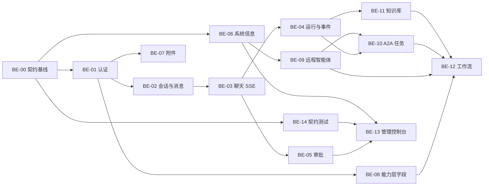

# 后端工作包与验收

- 用途：把 [`contract-delta.md`](contract-delta.md)、[`workflows.md`](workflows.md)、[`admin-console.md`](admin-console.md) 拆成可建 issue、可排期、可验收的工作包
- 使用方式：每个 `BE-xx` 可直接作为 epic；子项作为 issue；验收标准作为 PR 检查项
- 规模：S（1–2 天）、M（3–5 天）、L（1–2 周）、XL（2 周以上，需拆分）
- 排序原则：先契约与主链路，再能力层，再 A2A/知识库，最后工作流与管理端

---

## 1. 优先级总表

| ID | 工作包 | 里程碑 | 优先级 | 依赖 | 规模 | 主要产出 |
|---|---|---|---|---|---|---|
| BE-00 | 契约基线 | M1 | P0 | — | M | OpenAPI、错误信封、分页、枚举、fixtures、契约测试骨架 |
| BE-01 | 认证与账号 | M1 | P0 | BE-00 | M | 注册/登录/刷新/登出/me、角色、改资料/密码 |
| BE-02 | 会话与消息 | M1 | P0 | BE-01 | M | 会话 CRUD、消息分页、搜索、消息数、待审批标记 |
| BE-03 | 聊天 SSE 主链路 | M1–M4（子包分批） | P0 | BE-01/02 | XL | `run.started`、消息流、取消、HITL 流；工具/技能/引用随 M2/M4 |
| BE-04 | 运行与事件 | M1 | P0 | BE-03 | M | `GET /runs/{id}`、`/events`、cancel、resume |
| BE-05 | 审批 | M1.5 | P0 | BE-03/04 | M | 审批表、`approval.required`、列表/详情/决定、过期 |
| BE-06 | 系统信息 | M1 | P0 | BE-00 | S | 模型目录、推理等级、能力开关、限额、版本 |
| BE-07 | 附件 | M1.5 | P1 | BE-01/02 | M | `attachments` 表、上传、校验、清理、聊天集成 |
| BE-08 | 个人能力层字段 | M1.5 | P1 | BE-01 | L | 指令/记忆/技能/MCP 的字段、catalog、effective、check |
| BE-09 | 远程智能体 | M2 | P1 | BE-01/06 | M | preview、健康四态、最近检查/任务、统计 |
| BE-10 | A2A 任务 | M2 | P1 | BE-04/09 | L | 8 状态、列表/详情/统计、resume/authorize/reject |
| BE-11 | 知识库 | M4 | P2 | BE-07 | L | 统计、上传状态、重试、重建、检索元数据 |
| BE-12 | 工作流 | X1 待立项 | P2 | BE-08/09/10/11 | L | 模板 CRUD/版本/发布、运行集成、步骤事件 |
| BE-13 | 管理控制台 | X2 待立项 | P2 | BE-05/06/14 | XL | 概览、审计、用户、RBAC、菜单、字典、设置 |
| BE-14 | 契约测试与回归 | 持续 | P0 | BE-00 | M | fixtures 快照、SSE 顺序、权限矩阵、OpenAPI diff |

> P0 不等于「全部同时做」；P0 内部按第 4 节波次推进。BE-13 是 XL，必须拆成 BE-13A/B/C。
>
> **2026-11-10 编号说明**：BE-12/BE-13 的「M5+」是交接提案，不是后端路线图的 M5；当前工作流/完整管理台为 X1/X2 待立项，见 [../roadmap.md](../roadmap.md)。

---

## 2. 依赖图

并行建议：

- BE-06 可在 BE-01 之前先做（只依赖配置）；
- BE-07 / BE-08 可在 BE-03 收尾阶段并行；
- BE-10 / BE-11 可并行，但都依赖 BE-04；
- BE-12 / BE-13 不建议提前，前置能力未稳定会反复返工。

---

## 3. 工作包详情

### BE-00 契约基线（M1 / P0 / M）

**目标**：让后续每个包都按同一套响应、错误、分页、枚举和样例开发，避免各写一套。

**范围**

- FastAPI 应用工厂、`/healthz`、`/openapi.json` 可访问；
- 统一错误信封 `{"error":{"code","message","request_id"}}`；
- 统一分页 `{items,next_cursor,has_more,stats?}`；
- 统一时间/ID/枚举规范（见 `contract-delta.md` 第 1 节）；
- `X-Request-ID` 中间件；
- OpenAPI tag/description/示例；
- fixtures 目录与契约测试骨架；
- 枚举常量集中定义（task state、health status、run status、approval status）。

**验收**

- [ ] 任意 4xx/5xx 都返回统一信封，含 `request_id`；
- [ ] 列表接口都有 `next_cursor/has_more`；
- [ ] OpenAPI 在 `/docs` 可读，所有新增端点有示例；
- [ ] fixtures 可被 pytest 与前端 mock 同时引用；
- [ ] 枚举值只在一处定义，前后端样例一致。

---

### BE-01 认证与账号（M1 / P0 / M）

**目标**：完成注册、登录、刷新、登出、当前用户；补资料与密码修改。

**范围**

- `users` 表与迁移；pwdlib(argon2) 哈希；
- `POST /auth/register`、`/login`、`/refresh`、`/logout`；
- `GET /auth/me`：`id/email/display_name/status/role/created_at/last_login_at`；
- `PATCH /auth/me`：`display_name`（可选，不阻塞 M1 闭环）；
- `POST /auth/change-password`（可选，不阻塞 M1 闭环）；
- access/refresh 双令牌、旋转、吊销；
- 登录/注册限流；
- 登录成功/失败写审计（M1.5 起）。

**验收**

- [ ] 注册后可直接登录，密码不以明文落库；
- [ ] access 过期后 refresh 可换新，旧 refresh 失效；
- [ ] 登出后 refresh 失效；
- [ ] 重复邮箱返回 409；
- [ ] 错误密码返回统一 401；
- [ ] 修改密码后旧 token 按策略失效；
- [ ] 越权访问他人资源返回 404。

---

### BE-02 会话与消息（M1 / P0 / M）

**目标**：会话列表、搜索、消息历史、消息数、待审批标记。

**范围**

- `conversations` / `messages` 表与迁移；
- `GET/POST /conversations`、`GET/PATCH/DELETE /conversations/{id}`；
- `GET /conversations/{id}/messages`（cursor、倒序）；
- `q` 标题搜索；`status` 筛选；
- `message_count`、`last_message_preview`、`pending_approval_count`；
- 消息 `client_message_id`、`capabilities`、`citations`、`attachments`、`artifacts`、`usage`、`error`；
- 软删除与归档。

**验收**

- [ ] 列表按 `last_message_at desc`，归档会话可筛选；
- [ ] `q` 只搜标题，大小写不敏感；
- [ ] 消息分页不重不漏，`client_message_id` 可幂等；
- [ ] 消息数不含 tool/system；
- [ ] 待审批数与审批表一致；
- [ ] 删除为软删，30 天内可运维恢复（或明确不可恢复）。

---

### BE-03 聊天 SSE 主链路（M1 / P0 / XL）

**目标**：从「发一条消息」到「流式完成/取消/中断」的完整闭环。

> 后端 roadmap 的 M1 只要求 `message.delta` / `message.done`；工具事件属于 M2，知识引用属于 M4。本包按「页面依赖」拆成三个子包，不要为了前端演示强行把 M2/M4 的能力塞进 M1。

建议拆成三个子包：

#### BE-03A 流骨架

- `POST /chat/stream` 创建 user message + run；
- 响应头 `X-Run-ID`；
- `run.started`、`message.created`、`message.started`、`message.delta`、`message.done`；
- assistant 消息完成后落库；
- 同一会话并发 409；
- 15 秒心跳。

#### BE-03B 事件与字段（M1 末–M4，按依赖分批）

- `model`、`reasoning_effort` 白名单校验（M1 末）；
- `usage`、`first_token_ms`、`duration_ms`（M1）；
- `notice`、`content_type`、Markdown 原文落库（M1）；
- `tool.start/result`、`skill.activated`（M2，依赖工具/技能层）；
- `citations`（M4，依赖知识库）；
- `reasoning.delta/done`（模型支持时，M2）；
- 事件持久化到 `run_events`（供 BE-04 回放，M1）。

#### BE-03C 取消与 HITL

- `POST /runs/{id}/cancel` 与流内 `finish_reason=canceled`；
- `approval.required` / `a2a.input_required` / `a2a.auth_required` 期间保持流（D8）；
- 决定/补充信息后同一流继续；
- 超时 `finish_reason=interrupted`；
- 客户端断开不取消，运行继续/保持中断。

**验收**

- [ ] 首个事件或响应头能拿到 `run_id`；
- [ ] `message.started` 在第一个 delta 之前；
- [ ] `message.done` 是正常结束的最后一个事件；
- [ ] 取消后已生成内容保留，`finish_reason=canceled`；
- [ ] 断线后 `GET /runs/{id}` 能拿到最终状态；
- [ ] HITL 期间审批卡可达，批准后同一流继续输出；
- [ ] 未知事件不导致前端崩溃；
- [ ] 同一会话并发返回 409 `run_in_progress`。

---

### BE-04 运行与事件（M1 / P0 / M）

**目标**：运行详情、事件回放、取消、恢复。

**范围**

- `GET /runs/{id}`：状态、模型、用量、时长、首 token、pending、workflow、消息 ID；
- `GET /runs/{id}/events`：`seq/type/status/payload` 分页；
- `POST /runs/{id}/cancel`；
- `POST /runs/{id}/resume`（input_required）；
- `run_events` 表、事件写入与清理策略。

**验收**

- [ ] 事件 `seq` 单调递增，可按 `after_seq` 增量取；
- [ ] 轨迹行（request/message/skill/tool/a2a/mcp/approval，另含 workflow/notice/error）都能取到；
- [ ] `duration_ms/first_token_ms/usage` 与实际一致；
- [ ] 已结束 run 取消返回 409 并带当前状态；
- [ ] 事件回放不依赖内存队列，重启后可读。

---

### BE-05 审批（M1.5 / P0 / M）

**目标**：HITL 审批单、列表、决定、过期与恢复。

**范围**

- `approvals` 表与最小切片；
- `approval.required` 事件字段（source/executor/target/side_effect/risk/expires_at）；
- `GET /approvals`、`GET /approvals/{id}`、`POST /approvals/{id}/decision`；
- 批准后恢复 run；拒绝后终止；
- 重复决定/过期 409；
- 审计 `approval.decide`。

**验收**

- [ ] 审批卡六个展示字段齐全（source/executor/target/side_effect/risk/tool_display_name）；
- [ ] 批准后 run 恢复，`resumed=true`；
- [ ] 拒绝后 run 不再执行该工具；
- [ ] 重复决定返回 409；
- [ ] 过期后 status=expired，run 取消；
- [ ] 并发两个决定只有一个成功。

---

### BE-06 系统信息（M1 / P0 / S）

**目标**：前端能力开关、模型菜单、设置页、关于页的数据源。

**范围**

- `GET /system/info` 完整 schema（见 `contract-delta.md` 第 11 节）；
- 模型目录、推理等级、Embedding、生成参数、A2A 地址、能力开关、限额；
- 配置来源：环境变量 + `system_settings`，缺失时给默认值；
- 不返回密钥。

**验收**

- [ ] 模型菜单可渲染；不支持推理时 `reasoning_efforts=[]`；
- [ ] `capabilities.workflows=false` 时前端能隐藏入口；
- [ ] `limits` 与后端实际校验一致；
- [ ] 缺配置时不 500，返回安全默认值；
- [ ] 响应缓存策略明确（建议 60 秒）。

---

### BE-07 附件（M1.5 / P1 / M）

**目标**：对话附件上传与引用，独立于知识库上传。

**范围**

- `attachments` 表、对象存储（本地开发可磁盘）；
- `POST /attachments`（multipart）、`GET /attachments?conversation_id=`、`DELETE /attachments/{id}`；
- MIME/大小/数量校验、checksum 去重；
- 聊天请求 `attachments` 校验与消息回填；
- 30 天清理任务；生成产物复用同一张表（`purpose=artifact`）。

**验收**

- [ ] 上传返回 `status=ready` 与 ID；
- [ ] 超限/类型不支持返回明确错误码；
- [ ] 他人附件不可用（404/422）；
- [ ] 附件随消息展示，删除消息不立即删文件（按保留策略）；
- [ ] 清理任务不会删除仍被消息引用的附件。

---

### BE-08 个人能力层字段（M1.5 / P1 / L）

**目标**：在现有 M1.5 设计上补齐前端字段，不改变已有端点形状。

**范围**

- 指令：`source`、`max_chars`、`updated_at` 确认；
- 记忆：`source.conversation_title`、`stats`、`kind` 枚举；
- 技能：`effective_enabled`、`editable`、`estimated_tokens`、`catalog`、`stats`、导入 warnings；
- MCP：`effective_enabled`、`write_tools_allowed`、`admin_only_write_tools`、`last_error`、`check` 响应、`available` 形状；
- 能力开关与 `notice` 降级。

**验收**

- [ ] 系统技能/MCP 的启停与用户覆盖状态正确；
- [ ] 普通用户看不到系统写工具可用；
- [ ] 技能目录只返回启用项；
- [ ] MCP 检查失败返回结构化错误，不 500；
- [ ] 记忆来源能显示会话标题；
- [ ] 能力不可用时对话不中断，只发 `notice`。

---

### BE-09 远程智能体（M2 / P1 / M）

**目标**：智能体页的注册预览、健康四态、最近检查/任务、统计。

**范围**

- `GET/POST/PATCH/DELETE /agents` 字段补齐；
- `POST /agents/preview`；
- `POST /agents/{id}/refresh`、`/health`；
- `health_status` 四态（`unknown/healthy/degraded/unhealthy`）；
- `last_latency_ms`、`last_error`、`consecutive_failures`、`recent_task`；
- SSRF/Card 同源校验。

**验收**

- [ ] 预览不落库，确认注册才创建；
- [ ] Card 非法返回 422 `agent_card_invalid`，URL 不允许返回 422 `agent_url_not_allowed`；
- [ ] 健康检查更新状态与延迟；
- [ ] 连续失败进入 `degraded`/`unhealthy`，恢复后回 `healthy`；
- [ ] 删除有运行中任务的 Agent 返回 409；
- [ ] 明确 Agent 是全局注册表还是个人资源；v1 建议全局可读、写操作受权限控制；删除为软删，历史任务不丢。

---

### BE-10 A2A 任务（M2 / P1 / L）

**目标**：任务页 8 状态、详情、统计、三个后续动作。

**范围**

- `a2a_tasks` 字段补齐：`input_request`、`auth_request`、`progress`、`last_event_at`、`duration_ms`；
- `a2a_task_events` 状态时间线；
- `GET /tasks` 筛选/统计；
- `GET /tasks/{id}` 详情（request/result/error/timeline/available_actions）；
- `POST /tasks/{id}/cancel`；
- `POST /tasks/{id}/resume`、`/authorize`、`/reject`；
- 状态映射与审计。

**验收**

- [ ] 8 状态都能在列表与详情出现；
- [ ] `input_required` 补充信息后沿用同一 `a2a_task_id`；
- [ ] `auth_required` 拒绝后 `state=rejected`，不重试；
- [ ] `available_actions` 与状态一致；
- [ ] 时间线按时间排序，含耗时；
- [ ] 取消级联到远程任务（尽力而为）；
- [ ] 终态动作返回 409。

---

### BE-11 知识库（M4 / P2 / L）

**目标**：知识库页的统计、上传状态、重试、重建、检索调试。

**范围**

- 文档入库/切分/Embedding/索引；
- `GET /knowledge/documents` 筛选/统计；
- `POST /knowledge/documents`（multipart）、`GET/DELETE`；
- `POST /knowledge/documents/{id}/retry`；
- `POST /knowledge/rebuild`（单文档/全量）；
- `POST /knowledge/search` 命中元数据；
- D7 权限方案落地。

**验收**

- [ ] `pending/indexing/ready/failed` 状态可轮询；
- [ ] 失败文档可重试，状态回到 `indexing`；
- [ ] 重建不阻塞检索（旧索引可用）；
- [ ] 检索结果含标题/分类/块序号/分数；
- [ ] 重复 checksum 返回 409 + 已有文档 ID；
- [ ] 权限符合 D7（全局管理员或 owner）；
- [ ] 删除文档级联删除 chunks 与向量。

---

### BE-12 工作流（X1 待立项 / P2 / L）

**前置**：D1 选择 A，且后端 `architecture.md` 已补 ADR；否则不启动或改为 B 的独立设计。

**范围**

- `workflows` / `workflow_versions` / `workflow_run_steps` 表；
- CRUD、发布/停用/复制、版本、导入导出；
- `GET /workflows/catalog` 步骤目录（技能/检索/工具/A2A/MCP/审批）；
- `chat/stream` 的 `workflow_id`、上下文互斥；
- 计划注入、步骤匹配、`workflow.step` 事件；
- 运行记录与统计。

**验收**

- 见 [`workflows.md`](workflows.md) 第 10.2 节。

---

### BE-13 管理控制台（X2 待立项 / P2 / XL）

拆成三个子包，不要一次交付。

#### BE-13A M5.0 最小可用

- `GET /admin/overview`；
- `GET /admin/system/health`；
- `GET /admin/audit`、`/audit/{id}`；
- `GET /admin/users`（只读）；
- 现有系统设置三类接口接入；
- 管理端鉴权。

#### BE-13B M5.1 RBAC 与用户

- `roles/permissions/role_permissions/user_roles`；
- 用户邀请/启停/角色变更；
- 权限矩阵读写；
- 权限中间件与审计。

#### BE-13C M5.2 菜单与字典

- `menus` 树/排序/可见性；
- `dictionaries` / `dictionary_items`；
- 管理端设置分区（基础/认证/A2A/模型/数据/开关）。

**验收**

- 见 [`admin-console.md`](admin-console.md) 第 8 节。

---

### BE-14 契约测试与回归（持续 / P0 / M）

**目标**：让契约变更可被自动发现，而不是靠人工对文档。

**范围**

- `tests/contract/`：fixtures 快照；
- SSE 顺序测试（用假模型）；
- 权限矩阵测试；
- 分页/错误信封/未知枚举测试；
- OpenAPI diff（PR 中提示破坏性变更）；
- 前端 mock 复用同一 fixtures。

**验收**

- [ ] CI 中契约测试必跑；
- [ ] 删除/重命名字段会让测试失败；
- [ ] SSE 事件顺序或必填字段缺失会失败；
- [ ] 新增枚举值不会让旧测试失败；
- [ ] fixtures 与文档同源（生成或校验）。

---

## 4. 建议波次

| 波次 | 工作包 | 目标 |
|---|---|---|
| Wave 0 | BE-00、BE-06、BE-14 骨架 | 契约、系统信息、测试底座 |
| Wave 1 | BE-01、BE-02 | 能登录、能建会话、能看历史 |
| Wave 2 | BE-03A、BE-03B | 能流式对话、能看到用量；工具事件随 M2、引用随 M4 |
| Wave 3 | BE-04、BE-03C | 能取消、能回放、能处理 HITL |
| Wave 4 | BE-05、BE-07、BE-08 | 审批闭环、附件、个人能力 |
| Wave 5 | BE-09、BE-10 | 智能体与 A2A 任务 |
| Wave 6 | BE-11 | 知识库 |
| Wave 7 | BE-12、BE-13A | 工作流（若立项）、管理端最小集 |
| Wave 8 | BE-13B/C | RBAC、菜单、字典 |

> 波次不是严格串行：Wave 4 的 BE-08 可与 Wave 3 并行；Wave 5/6 可并行。关键是 BE-03/04 未稳定前不要启动 BE-12。

---

## 5. 联调准备

### 5.1 后端

- [ ] 开发环境允许 `http://localhost:5173` CORS（或走 Vite 代理）；
- [ ] SSE 响应禁用 Nginx `proxy_buffering`；
- [ ] 所有时间返回 UTC，前端本地化；
- [ ] 所有响应带 `X-Request-ID`；
- [ ] OpenAPI 示例可直接「Try it out」；
- [ ] 提供 `scripts/seed_demo.py`（可选）灌入 fixtures 数据；
- [ ] 假模型/假 A2A Agent 可用于本地联调。

### 5.2 前端

- [ ] `VITE_API_BASE_URL` 可切换 mock/真实后端；
- [ ] SSE 解析按 `seq` 排序；
- [ ] 未知事件/未知枚举降级；
- [ ] 停止按钮使用 `run_id`（响应头或 `run.started`）；
- [ ] 审批/补充信息期间保持流或按 D8 方案重连；
- [ ] 所有列表使用统一分页组件。

### 5.3 联调顺序

1. 登录 → `/auth/me`；
2. 会话列表 → 新建会话；
3. 发消息 → 看 SSE 原始帧；
4. 取消 → 看 `message.done`；
5. 审批 → 批准 → 看恢复；
6. 运行轨迹 → 看事件；
7. 智能体/任务/知识库按页面推进。

---

## 6. 全局 Definition of Done

每个工作包合入前必须满足：

- [ ] OpenAPI 已更新（字段、枚举、错误码、示例）；
- [ ] Pydantic schema 与 OpenAPI 一致；
- [ ] 契约测试通过（BE-14）；
- [ ] 权限与越权用例通过；
- [ ] 幂等/并发/超时行为符合契约；
- [ ] 审计事件已定义并写入；
- [ ] 文档回写：本包或 `contract-delta.md`；
- [ ] 前端可用 fixtures 完成 mock 验收。

---

## 7. 风险与缓解

| 风险 | 影响 | 缓解 |
|---|---|---|
| HITL 期间 SSE 生命周期未定（D8） | 批准后输出丢失/重复 | Wave 3 前拍板；先实现「保持流 + 超时」 |
| 工作流定位摇摆（D1） | 表结构返工 | X1 立项前不建表；先做模板 CRUD 原型验证 |
| 管理端范围过大（D2） | X2 延期 | 严格按管理端阶段切片，先只读 |
| 知识库权限未定（D7） | 越权/返工 | M4 前拍板；先按全局只读实现 |
| 健康枚举不一致 | 前端状态错乱 | BE-09 统一四态，前端映射表 |
| SSE 代理缓冲 | 流式变「一次性」 | 联调清单强制检查，Nginx 配置入文档 |
| 附件存储未定（D5） | 上线阻塞 | 先本地磁盘 + 抽象接口，后续换对象存储 |
| 多实例 SSE | 扩展受限 | M6 前单实例；预留 Redis Stream 方案 |
| OpenAPI 与实现漂移 | 前端返工 | BE-14 自动 diff + fixtures 同源 |

---

## 8. 决策 → 工作包映射

| 决策 | 阻塞的工作包 | 当前状态 / 最晚拍板 |
|---|---|---|
| D1 工作流定位 | BE-12 | X1 立项前 |
| D2 管理端范围 | BE-13 | X2 立项前 |
| D3 模型/推理等级 | BE-03B、BE-06 | 已按推荐项落地（`/system/info` 为空时隐藏） |
| D4 知识库选择字段 | BE-03B、BE-11 | 已定为 `knowledge_categories` |
| D5 附件存储 | BE-07 | 已落地（M1.5 附件与受控下载） |
| D6 任务动作模型 | BE-10 | 已落地（任务级 resume/authorize/reject） |
| D7 知识库归属 | BE-11 | M4 前 |
| D8 HITL 流生命周期 | BE-03C、BE-04 | 已落地（保持流 + 超时） |
