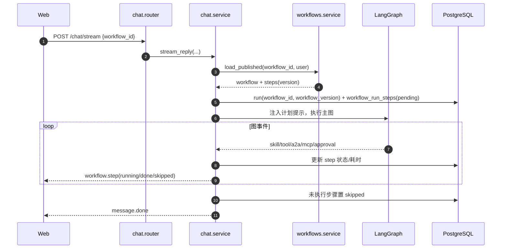

# 工作流：轻量步骤模板契约

- 状态：**设计目标**，后端无 `workflows` 表/API，且 `agent-hub/docs/architecture.md` 明确「不做通用工作流编排器（BPMN/低代码画布）」
- 来源：用户明确要求保留的原型能力（v7 工作流页 + 输入栏「+ → 工作流」）
- 决策：D1，见 [`README.md`](README.md) 第 5 节
- 结论先行：建议按 **A. 轻量步骤模板** 落地；不建议删除，也不建议做成独立 BPMN 执行引擎

---

## 1. 为什么单独一份文档

工作流是原型里唯一「产品形态明确、后端完全空白、且与架构非目标冲突」的能力。它不能像附件或字段那样顺手补一个接口，必须先回答三个问题：

1. 它是**执行引擎**，还是**计划模板**？
2. 它和 LangGraph 主图是什么关系？
3. 它的表结构、版本、运行记录、审批如何落地？

这三个问题的答案决定了后端是「加一张表 + 一个字段」，还是「再写一个编排器」。本文件给出可实现的收敛方案，供 D1 拍板。

---

## 2. 定位决策

### 2.1 三种方案

| 方案 | 语义 | 后端工作量 | 与架构关系 | 推荐度 |
|---|---|---|---|---|
| **A. 轻量步骤模板** | 工作流是一组有序步骤声明；运行时作为「计划提示 + 轨迹记录」交给主图执行 | 中（1–3 张表 + 校验 + 事件） | 不违背「不做通用编排器」 | ★★★★★ |
| **B. 确定性线性执行器** | 后端按步骤顺序逐步执行，步骤间传递输入/输出，支持暂停/恢复 | 大（新执行引擎、状态机、上下文传递、错误策略） | 接近「工作流引擎」，需要修改非目标 | ★★☆☆☆ |
| **C. 不做** | 删除工作流页与输入栏入口 | 小 | 无冲突 | ★☆☆☆☆（与用户明确要求冲突） |

### 2.2 推荐 A 的理由

1. **保留产品价值**：用户仍能「编排一条可复用的执行轨迹」，在对话里选择后按轨迹推进；
2. **复用主图能力**：工具调用、审批、A2A、MCP、知识检索都已经在主图里，工作流只负责「声明顺序与意图」；
3. **可渐进增强**：先做模板与轨迹，后续若确有确定性编排需求，再升级到 B；
4. **风险可控**：不会因为「模型没严格按步骤走」导致整轮失败；轨迹会如实记录跳过/偏离。

### 2.3 落地前置：ADR 与 MVP 切片

工作流不是「补一个字段」，而是一个新子系统。启动前必须：

1. 在后端 `docs/architecture.md` 补一条 ADR/决策记录，明确「轻量步骤模板」不违背「不做通用工作流编排器」的非目标；
2. 由产品/后端确认 D1，未确认前**不建表、不排期**；
3. 以功能开关 `capabilities.workflows=false` 上线，确认后再打开。

MVP 切片（建议）：

| 能力 | MVP | 后续 |
|---|---|---|
| 工作流 CRUD、发布/停用 | ✅ | — |
| 在对话中选择并记录 `workflow_id/version` | ✅ | — |
| `workflow.step` 轨迹事件 | ✅ | — |
| 步骤目录 `GET /workflows/catalog` | ✅（编辑器必需） | — |
| 版本历史/回滚 | — | P1 |
| 复制、导入/导出 | — | P1 |
| `workflow_run_steps` 表 | —（可由 `run_events` 派生） | P1 |
| 确定性执行/分支/循环 | — | 不在本方案 |

> 如果 MVP 工期仍然过大，优先保留「模板 + 对话选择 + 轨迹」，把版本、导入导出、复制全部后置；不要为了页面完整度先做一堆 CRUD。

### 2.4 A 明确不做什么

- 不做 BPMN 画布、分支、循环、并行、条件网关；
- 不做步骤间的结构化输入/输出绑定（v1 由主图上下文自然传递）；
- 不做独立调度器、定时触发、事件触发；
- 不做跨工作流的子流程调用；
- 不保证「每一步一定执行」；只保证「声明被记录、执行被追踪、偏离可见」。

---

## 3. 产品语义

### 3.1 定义

> 工作流 = 有序步骤模板 + 发布版本 + 运行轨迹。

- 一个工作流包含 1–20 个步骤；
- 步骤类型：技能、检索、工具、远程智能体、MCP、审批；
- 工作流有 `draft` / `published` / `disabled` / `archived` 四种状态；
- 只有 `published` 可被对话选择；
- 编辑已发布工作流会产生新版本，历史版本保留；
- 删除是归档（历史运行记录保留）。

### 3.2 与手动上下文的关系

原型规则（已定）：**工作流与手动上下文互斥**。

- 选择工作流时，清空技能 / MCP / 知识库选择；
- 请求同时传 `workflow_id` 与 `skills/mcp_servers/mcp_tools/knowledge_categories` → `422 workflow_context_conflict`；
- 发送后清空本轮选择。

### 3.3 运行次数

- `run_count` = 使用该工作流的 run 数；
- 只统计实际发起且未在入参校验阶段失败的 run；
- 删除/归档后计数保留，用于历史展示。

### 3.4 状态与文案

| `status` | 列表标签 | 开关 |
|---|---|---|
| `draft` | 草稿 | 不可用/置灰 |
| `published` | 启用 | 开 |
| `disabled` | 已停用 | 关 |
| `archived` | 已归档 | 不在默认列表 |

> 原型把「未发布」和「已停用」都显示成「草稿」，实现时需要区分：`toggle off` 是 `disable`，不是回到 `draft`。
>
> 原型文案「步骤从上到下执行」「将按此顺序执行」在 A 方案下应改为「按声明顺序推进；无法执行时说明原因并标注跳过」。若产品要求严格串行执行，应选择 B，而不是在 A 上承诺确定性。

---

## 4. 数据模型

### 4.1 `workflows`

| 字段 | 类型 | 约束 | 说明 |
|---|---|---|---|
| `id` | uuid | PK | |
| `scope` | varchar(16) | check `('system','user')` | 系统模板 / 用户自建 |
| `owner_user_id` | uuid | FK users, cascade, null | 系统项为空 |
| `slug` | varchar(64) | not null | `[a-z0-9_-]`，同 scope 内唯一 |
| `name` | varchar(128) | not null | 展示名 |
| `description` | text | not null default '' | |
| `status` | varchar(16) | not null default 'draft' | `draft` / `published` / `disabled` / `archived` |
| `current_version` | int | not null default 1 | 当前版本号 |
| `run_count` | int | not null default 0 | 冗余计数，可异步更新 |
| `created_at` / `updated_at` | timestamptz | not null | |

索引：系统项 `UNIQUE (slug) WHERE scope='system'`、用户项 `UNIQUE (owner_user_id, slug) WHERE scope='user'`（与 `mcp_servers` 一致，避免 null owner 让唯一索引失效）、`(owner_user_id, status)`。

### 4.2 `workflow_versions`

| 字段 | 类型 | 约束 | 说明 |
|---|---|---|---|
| `id` | uuid | PK | |
| `workflow_id` | uuid | FK workflows, cascade | |
| `version` | int | not null | 从 1 递增 |
| `steps` | jsonb | not null | 步骤数组，见 4.3 |
| `changelog` | varchar(500) | not null default '' | |
| `created_by` | uuid | FK users, set null | |
| `created_at` | timestamptz | not null | |

约束：`UNIQUE (workflow_id, version)`。

### 4.3 步骤 Schema

```json
{
  "index": 1,
  "type": "skill",
  "name": "weekly-report",
  "ref": {
    "kind": "skill",
    "id": "skill-uuid",
    "slug": "weekly-report"
  },
  "config": {},
  "requires_approval": false
}
```

字段：

| 字段 | 类型 | 必填 | 说明 |
|---|---|---|---|
| `index` | int | 是 | 从 1 开始，连续 |
| `type` | enum | 是 | `skill` / `retrieval` / `tool` / `a2a` / `mcp` / `approval` |
| `name` | string | 是 | 展示名，1–128 字符 |
| `ref` | object | 条件必填 | 引用对象，`approval` 类型可为空 |
| `config` | object | 否 | 类型相关配置，默认 `{}` |
| `requires_approval` | bool | 否 | 该步骤执行前是否强制审批 |

`ref.kind` 与字段：

| `type` | `ref.kind` | 字段 | 示例 |
|---|---|---|---|
| `skill` | `skill` | `id`、`slug` | 系统/用户技能 |
| `retrieval` | `knowledge` | `categories`（可选） | 知识库检索 |
| `tool` | `native_tool` | `name` | `tickets.aggregate` |
| `a2a` | `a2a_agent` | `id`、`slug` | 已注册远程智能体 |
| `mcp` | `mcp_tool` | `server_id`、`tool_id`、`exposed_name` | MCP 工具 |
| `approval` | — | — | 审批检查点 |

> 原型步骤编辑器里的类型 `vector` 对应 API 的 `retrieval`；`skill` / `tool` / `a2a` / `mcp` / `approval` 同名。示例里的 `tickets.aggregate` / `repo.diff` 是原型 mock，实际必须从 `GET /workflows/catalog` 返回的原生工具目录选择；后端目前只定义了 `search_knowledge`、`save_memory`、`read_skill_file` 等工具。

校验规则：

1. 步骤数 1–20；
2. `index` 连续且唯一；
3. `type` 必须在枚举内；
4. 引用对象必须存在、属于当前用户可用范围（系统项或自己的项）；
5. `mcp` 步骤引用的工具 `risk` 为 `write` / `destructive` 时，`requires_approval` 必须为 true；
6. `approval` 步骤不能是第一步（否则没有可审批的动作）；
7. 总步骤数 / 引用数量受系统限额约束（建议每用户 50 个工作流）。

### 4.4 `workflow_run_steps`

用于轨迹与统计，不替代 `GET /runs/{id}/events`：

| 字段 | 类型 | 约束 | 说明 |
|---|---|---|---|
| `id` | uuid | PK | |
| `run_id` | uuid | FK runs, cascade | |
| `workflow_id` | uuid | FK workflows, set null | |
| `workflow_version` | int | not null | |
| `step_index` | int | not null | |
| `step_type` | varchar(16) | not null | |
| `step_name` | varchar(128) | not null | |
| `ref` | jsonb | not null default '{}' | |
| `status` | varchar(16) | not null | `pending` / `running` / `done` / `skipped` / `failed` |
| `started_at` / `finished_at` | timestamptz | null | |
| `duration_ms` | int | null | |
| `created_at` | timestamptz | not null | 用于 `(workflow_id, created_at desc)` 索引 |
| `error` | jsonb | null | |

索引：`(run_id, step_index)`、`(workflow_id, created_at desc)`。

> 不需要单独的 `workflow_runs` 表：一次工作流执行就是一条 `runs` 记录，`runs.workflow_id + workflow_version` 已足够；步骤明细放 `workflow_run_steps`。

### 4.5 扩展 `runs`

| 字段 | 类型 | 说明 |
|---|---|---|
| `workflow_id` | uuid null | FK workflows, set null |
| `workflow_version` | int null | 实际执行版本 |

---

## 5. API

### 5.1 `GET /api/v1/workflows`

查询：`status`、`q`、`scope`、`limit`、`cursor`。

列表项：

```json
{
  "id": "wf-uuid",
  "slug": "customer-weekly",
  "name": "客服周报",
  "description": "检索复盘与工单表，生成周报草稿，交给数据分析与措辞审阅，校验 Slack 频道后审批发布。",
  "scope": "user",
  "status": "published",
  "version": 2,
  "step_count": 7,
  "steps": [
    {"index": 1, "type": "skill", "name": "weekly-report", "requires_approval": false},
    {"index": 2, "type": "retrieval", "name": "search_knowledge", "requires_approval": false},
    {"index": 3, "type": "tool", "name": "tickets.aggregate", "requires_approval": false}
  ],
  "a2a_count": 2,
  "approval_count": 1,
  "run_count": 12,
  "updated_at": "2026-10-30T00:00:00Z"
}
```

> 列表返回轻量 `steps` 摘要（最多 20 步），避免前端为每张卡片再请求详情；完整 `ref/config` 只在详情返回。

`stats`：`{"total":3,"published":2,"draft":1,"disabled":0,"avg_steps":5}`。

### 5.2 创建 / 详情 / 编辑

| 端点 | 说明 |
|---|---|
| `POST /api/v1/workflows` | 请求 `{name,description?,steps?}`；创建为 `draft`、`version=1`；返回详情 |
| `GET /api/v1/workflows/{id}` | 返回工作流 + 当前版本 `steps` |
| `PATCH /api/v1/workflows/{id}` | 请求 `{name?,description?,steps?}`；`steps` 变更时版本号 +1，旧版本保留 |
| `DELETE /api/v1/workflows/{id}` | 归档（`status=archived`），不物理删除；历史 run 保留 |

### 5.3 发布 / 停用 / 复制

| 端点 | 说明 |
|---|---|
| `POST /workflows/{id}/publish` | `draft/disabled → published`；校验步骤引用仍可用；失败 422 |
| `POST /workflows/{id}/disable` | `published → disabled`；已发起的 run 不受影响 |
| `POST /workflows/{id}/duplicate` | 复制为当前用户的 `draft`，名称加「副本」，版本重置为 1 |

### 5.4 版本

| 端点 | 说明 |
|---|---|
| `GET /workflows/{id}/versions` | 版本列表 `{version,changelog,created_by,created_at}` |
| `GET /workflows/{id}/versions/{version}` | 某版本详情（含 steps） |
| `POST /workflows/{id}/versions/{version}/restore` | 以旧版本创建新版本，`version=current+1` |

### 5.5 导入 / 导出

| 端点 | 说明 |
|---|---|
| `POST /workflows/import` | `application/json`，结构为导出格式；创建为 `draft`；返回详情 + `warnings` |
| `GET /workflows/{id}/export` | 返回可导入的 JSON（含 name/description/steps，不含 ID/owner） |

导出格式：

```json
{
  "schema_version": 1,
  "name": "客服周报",
  "description": "...",
  "steps": []
}
```

### 5.6 步骤目录

工作流编辑器需要知道「每一步可以选什么」，不能把原型里的 mock 名称写死。

`GET /api/v1/workflows/catalog`

```json
{
  "step_types": [
    {
      "type": "skill",
      "label": "技能",
      "targets": [
        {"kind": "skill", "id": "uuid", "slug": "weekly-report", "name": "周报生成", "description": "...", "estimated_tokens": 820}
      ]
    },
    {
      "type": "retrieval",
      "label": "检索",
      "targets": [
        {"kind": "knowledge", "categories": ["客服", "产品", "售后"]}
      ]
    },
    {
      "type": "tool",
      "label": "工具",
      "targets": [
        {"kind": "native_tool", "name": "tickets.aggregate", "description": "...", "risk": "read"}
      ]
    },
    {
      "type": "a2a",
      "label": "远程智能体",
      "targets": [
        {"kind": "a2a_agent", "id": "uuid", "slug": "data-analyst", "name": "Data Analyst", "health_status": "healthy"}
      ]
    },
    {
      "type": "mcp",
      "label": "MCP",
      "targets": [
        {"kind": "mcp_tool", "server_id": "uuid", "tool_id": "uuid", "exposed_name": "mcp__slack_mcp__post_message", "name": "post_message", "risk": "write", "requires_approval": true}
      ]
    },
    {
      "type": "approval",
      "label": "审批",
      "targets": [
        {"kind": "approval_policy", "name": "发送审批", "description": "写操作前暂停，等待人工确认"}
      ]
    }
  ]
}
```

约定：

- 只返回当前用户可用、已启用的目标；
- `a2a` 只返回 `health_status != unhealthy` 的 Agent；
- `mcp` 只返回 `user_allowed=true` 的工具；
- `approval` 的 targets 由系统内置策略提供，不允许用户自定义脚本；
- 结果可缓存 60 秒，发布/启用状态变化后失效；
- 前端编辑器只允许从该目录选择，不允许自由文本。

### 5.7 在对话中使用

- `POST /chat/stream` 增加 `workflow_id`、`workflow_version?`；
- 后端加载已发布版本；未发布/已停用 → `409 workflow_disabled`；
- 与手动上下文互斥（见 3.2）；
- 开始执行时写 `runs.workflow_id/workflow_version`；
- 按第 6 节发 `workflow.step` 事件。

### 5.8 错误码

| HTTP | code | 场景 |
|---|---|---|
| 404 | `workflow_not_found` | 不存在或不属于当前用户 |
| 409 | `workflow_disabled` | 未发布/已停用/已归档 |
| 422 | `workflow_context_conflict` | 同时传工作流与手动上下文 |
| 422 | `workflow_invalid` | 步骤结构非法 |
| 422 | `workflow_step_invalid` | 单步引用/配置非法 |
| 422 | `workflow_ref_not_found` | 引用的技能/MCP/Agent 不存在或不可用 |
| 409 | `workflow_publish_conflict` | 并发发布/版本冲突 |

---

## 6. 执行语义 A（推荐）

### 6.1 总览



### 6.2 计划注入

后端把工作流转换为一段**系统提示词中的计划块**（不是用户消息）：

```text
<workflow name="客服周报" version="2">
按以下顺序推进；若某步无法执行，说明原因并继续，不要编造结果：
1. [skill] weekly-report
2. [retrieval] search_knowledge（category=客服）
3. [tool] tickets.aggregate
4. [a2a] data-analyst
5. [a2a] editorial-reviewer
6. [mcp] slack · conversations.info
7. [approval] 发送审批
</workflow>
```

约束：

- 计划块不覆盖系统安全规则与工具权限；
- 计划块不包含远程返回内容；
- 计划块长度受 token 预算限制，超长时只保留步骤名与类型；
- 工作流不改变「工具是否需要审批」的判断，审批仍由工具策略决定。

### 6.3 事件映射

后端按事件来源匹配步骤：

| 事件 | 匹配 `step_type` | 说明 |
|---|---|---|
| `skill.activated` | `skill` | 按 `skill_id`/`slug` 匹配 |
| `tool.start(source=knowledge)` | `retrieval` | 按工具名匹配 |
| `tool.start(source=native)` | `tool` | 按 `tool` 名匹配 |
| `a2a.task` | `a2a` | 按 `agent.slug` 匹配 |
| `tool.start(source=mcp)` | `mcp` | 按 `server_id`/工具名匹配 |
| `approval.required` | `approval` | 按顺序匹配下一个审批步骤 |

匹配规则：

- 只在「当前步骤之后」找第一个匹配项，避免重复匹配；
- 匹配成功后发 `workflow.step(status=running)`，对应事件结束时发 `done`/`failed`；
- 没有匹配到的事件仍正常展示，但不归属步骤；
- run 结束时仍未执行的步骤标记 `skipped`；
- 同一步骤被多次触发时，只记录第一次，后续计入 `payload.repeat_count`。

### 6.4 `workflow.step` 事件

```json
{
  "run_id": "9a8b...",
  "workflow_id": "wf...",
  "workflow_version": 2,
  "step_index": 3,
  "step_type": "tool",
  "name": "tickets.aggregate",
  "status": "running",
  "duration_ms": null,
  "ts": "2026-11-08T14:41:20Z",
  "seq": 12
}
```

状态：`pending` / `running` / `done` / `skipped` / `failed`。

前端行为：

- 运行条显示「工作流 客服周报 · 3/7」；
- 轨迹页把步骤与事件行关联；
- `skipped` 用灰色标注，不视为错误；
- `failed` 显示错误摘要，run 是否失败由主图决定。

### 6.5 审批步骤

- `approval` 步骤表示「该工作流要求在任何写操作前人工确认」；
- 后端在工具策略层强制：工作流声明 `requires_approval` 或工具本身 `requires_approval` 时，必须审批；
- `approval.required` 到达时，把对应 `approval` 步骤置 `running`；决定后置 `done`（批准）或 `failed`（拒绝）；
- 如果主图没有触发任何写操作，`approval` 步骤最终为 `skipped`，并在轨迹中说明「本轮无写操作」；
- 不承诺「审批步骤一定在固定顺序执行」——由主图实际动作决定。

### 6.6 失败与偏离

| 情况 | 行为 |
|---|---|
| 引用的技能/MCP/Agent 在运行时不可用 | 该步骤 `failed`，发 `notice`，主图可继续其余步骤 |
| 模型跳过某步 | run 结束置 `skipped`，不报错 |
| 工具报错但可恢复 | 步骤 `failed`，run 继续；是否重试由工具策略决定 |
| run 被取消 | 未完成步骤 `skipped`，run `canceled` |
| 审批被拒 | 审批步骤 `failed`，run 按现有审批语义取消/继续 |

### 6.7 与 `GET /runs/{id}/events` 的关系

- `workflow.step` 同时进入 run 事件流，使用 `type=workflow`（`contract-delta.md` 第 5.2 节已列入枚举）；
- `payload` 包含 `workflow_id`、`workflow_version`、`step_index`、`step_type`、`name`、`status`、`duration_ms`；
- 轨迹页用 `workflow_run_steps` 渲染「执行轨道」，用 run events 渲染「事件明细」，两者不重复造数；
- `type=workflow` 的行默认折叠进对应步骤，不单独占用筛选标签。

---

## 7. 执行语义 B（仅在被选中时参考）

如果 D1 选择 B，需要额外定义：

1. 每步的输入/输出契约（上一步结果如何传给下一步）；
2. 步骤超时、重试、跳过策略；
3. 条件分支/循环是否需要（若需要，已超出 B，接近 BPMN）；
4. 审批暂停与恢复的执行器状态；
5. 独立执行器与主图的关系（工作流是否绕过主图）；
6. 幂等与断点恢复。

这会显著增加工期，并与「不做通用工作流编排器」的架构非目标冲突。除非出现明确的「必须确定性执行」的业务需求，否则不建议。

---

## 8. 前端交互 → API 映射

| 原型交互 | API |
|---|---|
| 工作流列表 / 统计 | `GET /workflows` + `stats` |
| 新建工作流 | `POST /workflows` |
| 编辑名称/描述/步骤 | `PATCH /workflows/{id}` |
| 保存为草稿 | `PATCH` 后保持 `draft` |
| 发布 / 启用 | `POST /workflows/{id}/publish` |
| 停用 | `POST /workflows/{id}/disable` |
| 复制 | `POST /workflows/{id}/duplicate` |
| 删除 | `DELETE /workflows/{id}`（归档） |
| 导入 | `POST /workflows/import` |
| 在对话中使用 | `POST /chat/stream {workflow_id}` |
| 步骤编辑器类型下拉 | `GET /workflows/catalog` + 第 4.3 节 `type/ref` |
| 运行次数 | 列表 `run_count` |
| 运行轨迹 | `workflow.step` + `GET /runs/{id}/events` |

前端校验（与后端一致）：

- 名称必填；
- 至少一个步骤；
- 步骤引用从可用目录选择，不允许自由文本；
- 写操作步骤默认勾选「需审批」；
- 未保存关闭需确认；
- 发布前提示「发布后可在对话中选择」。

---

## 9. 权限与审计

| 操作 | 权限 |
|---|---|
| 查看系统工作流 | 所有登录用户 |
| 使用已发布工作流 | 所有登录用户（受能力开关限制） |
| 创建/编辑/删除自己的 | 所有者 |
| 发布自己的 | 所有者 + `workflow:publish`（若启用 RBAC） |
| 管理系统工作流 | 管理员 |
| 查看他人工作流 | 404 |

审计动作：`workflow.create`、`workflow.update`、`workflow.publish`、`workflow.disable`、`workflow.delete`、`workflow.duplicate`、`workflow.import`、`workflow.run`。

---

## 10. 里程碑与验收

### 10.1 里程碑建议

- **后端 M5 后评估（前端 X1 待立项）**：先做模板 CRUD + 发布 + 对话选择 + 轨迹事件；
- **立项后第二阶段**：版本历史、导入导出、复制、统计；
- 不建议早于 A2A 与知识库落地，因为它依赖这两类步骤的真实可用性。

> 编号说明：以上是工作流的阶段建议，不是后端路线图的 M5/M6；后端尚未立项，前端归 X1 待立项，见 [../roadmap.md](../roadmap.md)。

### 10.2 验收清单

- [ ] 创建工作流草稿，步骤引用技能/MCP/Agent 均可选；
- [ ] 发布后出现在对话「+ → 工作流」菜单；
- [ ] 选择工作流后手动上下文被清空，服务端拒绝混合请求；
- [ ] 对话执行时 run 记录 `workflow_id/version`；
- [ ] 轨迹显示每一步 `running/done/skipped/failed` 与耗时；
- [ ] 模型跳过步骤时显示 `skipped`，不报错；
- [ ] 审批步骤与审批卡联动，拒绝后状态正确；
- [ ] 编辑已发布工作流产生新版本，旧 run 仍指向旧版本；
- [ ] 删除为归档，历史 run 仍可查看；
- [ ] 非所有者访问返回 404，管理员可管理；
- [ ] 能力开关 `capabilities.workflows=false` 时，导航与入口置灰。

### 10.3 前端验收

- 工作流页空态、草稿态、发布态、停用态；
- 步骤编辑器增删/上移/下移/类型切换/审批勾选；
- 未保存关闭确认；
- 发布前校验提示；
- 运行轨迹与步骤状态一致。

---

## 11. 开放问题

| ID | 问题 | 建议 |
|---|---|---|
| W1 | 工作流是否允许「无步骤」草稿？ | 允许草稿为空，发布时必须 ≥1 步 |
| W2 | 步骤引用被删除后，已发布工作流如何处理？ | 发布时校验；运行时缺失则 step failed + notice |
| W3 | 是否允许用户复制系统工作流？ | 允许，复制为个人草稿 |
| W4 | 工作流是否需要「输入变量」？ | v1 不做；后续用对话上下文 |
| W5 | 运行次数是否实时？ | 异步 +1，允许最终一致 |
| W6 | 审批步骤是否强制最后一步？ | 不强制；由工具策略决定实际审批点 |
| W7 | 系统工作流由谁维护？ | 管理员或仓库内置，启动时 upsert |

---

## 12. 对现有文档的影响

| 文档 | 变更 |
|---|---|
| 后端 `docs/api.md` | 新增工作流端点、`chat/stream` 字段、`workflow.step` 事件 |
| 后端 `docs/database.md` | 新增 3 张表、`runs` 2 列 |
| 后端 `docs/architecture.md` | 在「非目标」旁补一句「工作流为轻量步骤模板，非 BPMN 执行器」 |
| 前端 `docs/pages.md` | 工作流页从「目标形态」改为「待 D1 决策」 |
| 本包 `contract-delta.md` | 第 4、5 节补充 `workflow_id` 与 `workflow.step` |
