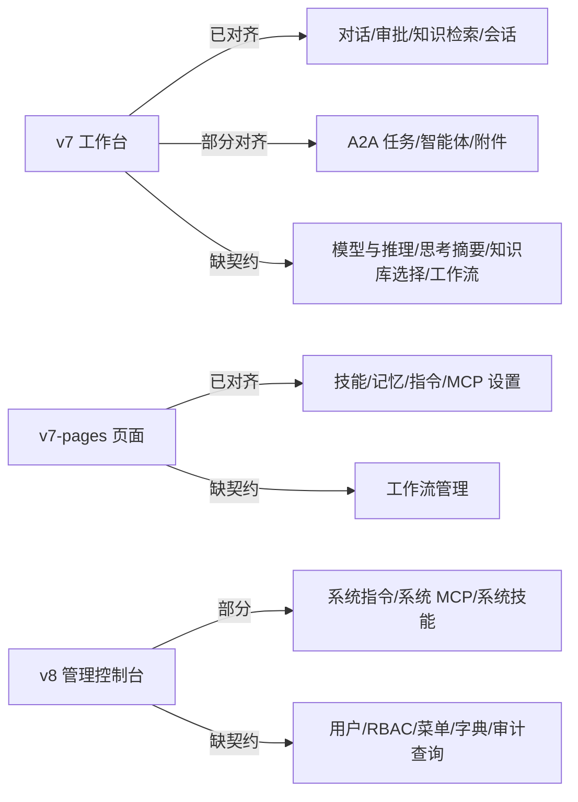

# Agent Hub 原型自检与前后端对齐报告

- 日期：2026-11-08
- 范围：`docs/prototypes/` 下的 v7 工作台、v7 页面样例、v8 管理控制台
- 对照依据：后端 `agent-hub` 的 `README`、`docs/api.md`、`docs/architecture.md`、`docs/database.md`、`docs/a2a.md`、`docs/roadmap.md` 与个人能力层设计；前端 `docs/pages.md`、`docs/architecture.md`、`docs/api.md`、`docs/roadmap.md` 及既有决策记录
- 结论：原型的信息架构与视觉方向成立；主要问题集中在**个人能力层缺失、A2A 状态覆盖不全、部分交互不可达，以及管理控制台/工作流明显超前于后端契约**。本轮已修复可直接修复的部分，剩余契约缺口在文末列出。

> **2026-11-10 编号说明**：本文的「M3 审批」「M5 体验」「M5+」「M5 后」均为 2026-11-08 的旧编号，已废弃。当前里程碑见 [../roadmap.md](../roadmap.md)：M3=A2A 入站、M5=审批与安全加固；工作流/完整管理台为 X1/X2 待立项。本文作为历史评审记录保留，不回改原结论。

## 1. 结论摘要

| 维度 | 评价 | 说明 |
|---|---|---|
| 前后端需求对齐 | 部分满足 | 对话、审批、知识库检索、智能体注册与任务列表基本对齐；M1.5 的 MCP/技能/记忆/指令管理、A2A 的 input-required/auth-required 状态此前缺失 |
| 实现可行性 | 工作台可行，管理后台超前 | A2A 尚未实现（`app/modules/a2a/` 只有 `.gitkeep`）；工作流、RBAC、菜单、字典、审计查询无后端表/接口；模型与推理等级、思考摘要、附件上传缺契约 |
| 前端设计合理性 | 基本合理 | 三栏工作台、过程时间线、运行轨迹、审批卡的方向清晰；此前存在审批入口不可达、运行中不能停止、`@` 文件选择未实现、危险操作无确认等问题 |
| 静态质量 | 良好 | 三份原型标签配对、id 唯一、JS 语法、DOM 引用均通过；此前缺 `--shadow-lg`、`--kind-a2a-soft` 两个变量，已补 |

## 2. 审查依据与现状

### 2.1 后端能力现状

后端仓库当前仍是 **M0 结构初始化**：只有目录、配置与设计文档，没有 Python 实现代码。因此本报告的“实现可能性”指**契约是否已经定义**，而不是接口今天能否调用。

关键事实：

- 对话、会话、审批、知识库、远程 Agent、A2A 任务、MCP、技能、记忆、指令均已有 API 设计；
- A2A 出站/入站标注为 M2/M3，`app/modules/a2a/` 只有 `.gitkeep`，当前没有任何真实远程智能体数据；
- `remote_agents`、`a2a_tasks`、`approvals`、`mcp_servers`、`mcp_tools`、`skills`、`system_settings`、`user_settings` 等表已设计；
- **没有** workflow/workflow_run 表，也没有对应 API；`architecture.md` 明确“不做通用工作流编排器（BPMN/低代码画布）”；
- 管理端只有平台指令、系统 MCP、系统技能三类接口；**没有**用户管理、角色权限、菜单、字典、审计查询接口（`audit_logs` 表已设计，查询接口留给 M5）；
- `chat/stream` 请求没有 `model` / `reasoning_effort` 字段；SSE 没有 reasoning/思考摘要事件；
- 附件上传端点尚未提供（`attachments` 只是附件 ID 列表）；
- 会话列表没有 `q` 搜索参数，也没有 `message_count` 字段；
- `GET /runs/{id}/events` 标注为“规划”。

### 2.2 前端现状

- `src/` 仍是 M0 空目录，没有 Vue 页面或请求层；本报告只审查 HTML 原型，不进入框架实现；
- v7 是对话工作台单页；v7-pages 是工作流/智能体/任务/知识库/设置页面样例；v8 是独立的管理控制台；
- 原型以 `localStorage` 保存主题，所有数据为演示数据，写操作以 toast 或本地 DOM 更新模拟。

## 3. 契约对照

### 3.1 工作台 v7

| 原型元素 | 后端契约 | 结论 |
|---|---|---|
| 流式消息、工具卡、技能卡、MCP 卡、审批卡 | `POST /chat/stream` + `message.*` / `tool.*` / `skill.activated` / `approval.required` | 对齐 |
| A2A 任务行与 artifact 抽屉 | `a2a.task` / `a2a.artifact` / `a2a.input_required` / `a2a.auth_required` | 部分对齐：原型只演示完成态，缺 input/auth 状态 |
| 运行轨迹抽屉 | `GET /runs/{id}`、`/runs/{id}/events`（规划） | 视觉与事件类型合理，接口待实现 |
| 会话重命名/归档/删除 | `PATCH/DELETE /conversations` | 对齐 |
| 会话搜索 | `GET /conversations` 无 `q` | 前端本地过滤可先做，后端需补 `q` |
| 会话消息数 | 会话表无 `message_count` | 需后端补字段或前端隐藏 |
| 输入栏「+」：附件 | `attachments` 字段有；上传端点无 | 字段对齐，上传链路缺契约 |
| 输入栏「+」：技能 | `skills`（≤3） | 对齐，已补 3 个上限提示 |
| 输入栏「+」：MCP | `mcp_servers`（≤5）/`mcp_tools`（≤10） | 此前缺失，已补服务器级选择与 5 个上限 |
| 输入栏「+」：知识库 | 请求无 `knowledge` 字段 | 不一致；保留界面，需后端补字段或改为前端提示 |
| 输入栏「+」：工作流 | 无 workflow 字段/表 | 不一致；保留为用户明确要求的设计，需后端评估契约 |
| 模型 / 推理等级选择 | `chat/stream` 无字段；`/system/info` 只读 | 不一致；保留交互，需后端扩展 |
| 思考卡 / 推理摘要 | 无 reasoning SSE 事件 | 不一致；需后端扩展 |
| 记忆保存提示 | `memory.saved` 事件已设计 | 原型未演示，M1.5 接入时补 |
| 审批入口 | `approval.required` + `GET/POST /approvals` | 已补顶部入口；审批列表页仍缺 |

### 3.2 页面样例 v7-pages

| 页面 | 后端契约 | 结论 |
|---|---|---|
| 智能体 | `GET/POST/PATCH/DELETE /agents`、`/refresh`、`/health` | 基本对齐；已补启停开关、原始 Card/鉴权入口、删除确认 |
| 任务 | `GET /tasks`、`GET /tasks/{id}`、`POST /tasks/{id}/cancel` | 此前只覆盖 4/8 状态；已补 input-required / auth-required 与筛选 |
| 知识库 | `POST/GET/DELETE /knowledge/documents`、`/search`、`/rebuild` | 已补重建索引、失败重试、复制检索结果；文档详情/分页仍待补 |
| 设置 | `/instructions`、`/memories`、`/skills`、`/mcp/servers`、`/system/info` | 此前缺 M1.5 四区块；已补“个人能力”区 |
| 工作流 | 无后端契约 | 保留；定位为轻量步骤模板，需后端 M5 后评估 |
| 账号资料修改 | 无 `PATCH /auth/me` | 原型已明确标注“接口待后端补” |

### 3.3 管理控制台 v8

| 页面 | 后端能力 | 结论 |
|---|---|---|
| 概览 | `/system/info`、`/healthz`（`/readyz` 规划） | 部分可行 |
| 用户管理 | 无管理端用户 API | 无契约 |
| 角色与权限 | `users.role` 只有 `user/admin`；无 roles/permissions 表 | 无契约（仅最小角色字段） |
| 菜单管理 | 无 menus 表/API | 无契约 |
| 字典管理 | 无 dictionaries 表/API | 无契约 |
| 审计日志 | `audit_logs` 表已设计；无查询 API | 表有、接口无 |
| 系统设置 | 平台指令、系统 MCP、系统技能三类接口 | 部分可行；认证策略、配额、数据保留等无契约 |

因此 v8 是**目标形态原型**，不应被理解为当前可实现的完整管理后台。已在概览页加入“原型范围”提示，并把环境标签改为“原型演示”。

## 4. 发现的问题与处理

### 4.1 P0：已修复

1. **设置页缺 M1.5 四区块**
   - 问题：后端个人能力层明确要求设置页扩展为「MCP / 技能 / 记忆 / 指令」，原 v7-pages 只有账号、模型、A2A、界面、关于。
   - 处理：新增 `settings-capabilities` 分区，包含指令编辑与生效来源、记忆列表/搜索/删除、技能启停/导入、MCP 启停/检查/凭据提示；导航增加“个人能力”。

2. **A2A 状态覆盖不全**
   - 问题：后端状态映射有 8 种（含 `input_required`、`auth_required`），任务页只展示运行中/完成/失败。
   - 处理：任务页新增两个状态样例、统计与筛选；补充“补充信息”“前往授权”“拒绝”等操作，明确沿用同一 taskId 继续。

3. **待审批入口不可达**
   - 问题：审批卡在时间线底部；折叠时才有“处理审批”链接，展开时用户可能看不到入口。
   - 处理：运行条“处理审批”在待审批时始终显示；顶部状态 chip 可点击滚动到审批卡并聚焦“批准”。

4. **运行中无法停止**
   - 问题：`pages.md` 要求流式时发送按钮变“停止”，原型此前是单独放一个停止按钮，且运行中直接禁用发送。
   - 处理：发送按钮与停止按钮合并为同一位置：`runActive` 时按钮切换为停止样式（红色、方块图标），点击取消本轮；空闲时恢复发送。审批后 1.8s 的模拟完成会被取消。

5. **`@` 文件选择缺失**
   - 问题：附件菜单提示“@ 选择文件”，但输入框没有实现。
   - 处理：输入 `@` 打开文件选择器，选择后在光标处插入 `@文件名` 并添加附件 chip；通过「+」菜单选择附件不会误触发。

6. **智能体缺少启停与 Card 操作**
   - 问题：后端 `PATCH /agents/{id}` 支持启停、鉴权配置，原型只有静态“已启用”。
   - 处理：卡片增加启停开关、统计联动、原始 Card/编辑鉴权入口、删除确认。

7. **知识库缺少关键操作**
   - 问题：后端有删除、重建、重试能力，原型只有列表与检索。
   - 处理：增加重建索引、失败行重试、复制检索结果；上传仍为原型占位。

8. **危险操作无确认**
   - 问题：工作流删除、智能体删除直接执行；工作流编辑器关闭会丢失未保存修改。
   - 处理：新增通用确认对话框；删除工作流/智能体前确认；工作流编辑器有未保存修改时关闭需确认。

9. **静态缺陷**
   - v7 使用未定义的 `--shadow-lg`，菜单阴影失效；v7-pages 使用未定义的 `--kind-a2a-soft`，智能体徽章背景透明；工具类型的 `#A9741F` 小字对 `#F3E9D3` 仅 3.34:1，不满足普通字号 AA；v7 的下载图标引用了未定义的 `#i-download`。
   - 处理：补齐两个 token 与下载图标 symbol；工具类型文字改用 `--amber-text`（4.76:1）。

10. **数据与文案一致性**
    - “3 ONLINE”与“2 健康 + 1 降级”矛盾；版本写成“M0”；“24 小时内可撤回”不是系统能力。
    - 处理：改为“2 ONLINE · 1 降级”“设计原型”“发布后可在 Slack 中删除”。

### 4.2 P1：需要后端契约或后续迭代

| 问题 | 影响 | 建议 |
|---|---|---|
| 工作流页与步骤编辑器无后端表/API | 前端可演示，无法持久化/执行 | 明确定位为轻量步骤模板（非 BPMN 画布）；M5 后评估 `workflows` / `workflow_runs` 契约 |
| v8 用户/角色/菜单/字典/审计查询无契约 | 管理后台大部分页面不可落地 | M5+ 补 RBAC（roles/permissions/user_roles）、menus、dictionaries、audit 查询；或先缩到“平台设置 + 系统 MCP/技能” |
| 模型/推理等级无 `chat/stream` 字段 | 输入栏选择只改本地标签 | 后端增加 `model`、`reasoning_effort`（或明确由服务端固定）；前端保留只读降级 |
| 思考卡无 reasoning SSE 事件 | 推理摘要无法实时展示 | 增加 `reasoning.delta` / `reasoning.done`，或改为仅展示 `message.delta` 中的可见推理 |
| 附件上传端点缺失 | 附件只能作为 ID 列表 | 补 `POST /attachments`（大小/类型限制、进度、失败重试） |
| 知识库选择无请求字段 | “support-kb” chip 无实际作用 | 补 `knowledge_base_ids`，或改为“检索范围提示”不随请求发送 |
| 会话搜索/消息数无字段 | 侧栏搜索只能本地过滤 | 补 `q` 与 `message_count`，或前端隐藏消息数 |
| 审批列表页缺失 | 只能从对话进入审批 | 可选页面 `GET /approvals`，M3 补 |
| 记忆事件卡未演示 | M1.5 的 `memory.saved` 无 UI 样例 | 接入时在时间线补“记忆已保存”卡 |
| 加载/错误/断线状态覆盖不足 | 原型偏“成功路径” | 补骨架屏、错误卡、断线重连提示；至少在设计规格中定义 |

### 4.3 P2：设计建议

- v8 的字号普遍偏小（8.5–10px），建议正式实现时把辅助文字提升到 11–12px；原型的密度可作为上限参考。
- 抽屉/对话框目前只做焦点返回，没有完整 focus trap；正式实现需加 Tab 循环与背景 `aria-hidden`。
- 移动端“设置”入口在账号菜单中，可达但不够显眼；如果设置是高频入口，可在主导航增加设置项。
- 运行轨迹的“技能”目前归入“工具”筛选；可考虑独立筛选或在标签上说明。
- 审批卡的“执行方/目标/副作用”依赖 `approval.required.payload` 的具体字段，正式契约应明确 payload 结构。

## 5. 前端设计合理性评估

**成立的部分**

- 三栏结构（会话侧栏 + 对话 + 运行详情）符合“对话为主、过程可查”的工作台定位；≤1180px 把运行详情改为抽屉，≤900px 把侧栏改为抽屉，断点合理。
- 过程时间线把工具、技能、A2A、MCP、审批分成不同颜色与卡片，信息层级清楚；折叠后只保留草稿与定稿，符合“过程可收起”的目标。
- 运行轨迹用“时间轴 + 聚合行 + 事件明细”三层表达，能支撑排障与审计，不只是装饰。
- 审批卡把风险、工具、目标、副作用放在一起，并把“批准/拒绝”作为明确决策，符合 HITL 场景。
- 智能体卡、任务表、知识库双栏的页面结构清晰，空态/状态标签基本齐全。

**已修正的不合理点**

- 待审批入口不可达 → 顶部 chip 与运行条双入口。
- 运行中不能停止 → 停止按钮与取消状态同步。
- `@` 提示与行为不一致 → 实现文件选择。
- 工作流与技能/知识库可同时选择，语义冲突 → 工作流与手动上下文互斥，选择其一时清空另一侧。
- 发送后“本轮”选择仍保留 → 发送后清空技能/MCP/知识库/工作流选择，符合“只影响本次请求”。

**仍需注意**

- 模型/推理等级、工作流、知识库选择这三类控件目前是“视觉先行”，正式实现前必须明确契约，否则会出现“能点但无效果”的落差。
- v8 的信息架构完整，但它是 M5+ 目标形态；建议在评审时把它和 v7 的交付范围分开，不要按同一里程碑排期。

## 6. 实现可行性风险

按落地顺序建议：

1. **M1**：对话闭环、会话 CRUD、SSE、审批最小切片；工作台只保留已对齐部分。
2. **M1.5**：设置页四区块、输入栏技能/MCP 选择、记忆/技能事件卡；这是当前原型补齐后最值得优先落地的能力层。
3. **M2/M3**：智能体注册、A2A 任务、input-required/auth-required 交互；任务页已有设计样例。
4. **M4**：知识库上传、重建、检索调试完善。
5. **M5+**：审批列表、审计查询、RBAC/菜单/字典；v8 按此范围拆分里程碑。
6. **工作流**：在 M5 后根据真实编排需求评估，不建议先于 A2A/知识库落地。

## 7. 本轮优化记录

| 文件 | 改动 |
|---|---|
| `ui-v7.html` | 补 `--shadow-lg`；审批顶部入口与常驻链接；发送按钮执行中切换为停止按钮与取消状态；`@` 文件选择；MCP 菜单与上限；工作流/手动上下文互斥；发送后清空本轮选择；轨迹“请求”计入消息筛选；统一/修正文案；工具类型对比度；抽屉与对话框焦点返回；清理重复注释 |
| `ui-v7-pages.html` | 补 `--shadow-lg`、`--kind-a2a-soft`；设置页新增“个人能力”四区块与交互；任务页补 input-required/auth-required 与筛选；智能体启停/统计/原始 Card/删除确认；知识库重建/重试/复制；工作流删除确认与未保存确认；版本文案 |
| `ui-v8-admin.html` | 概览新增“原型范围”提示；环境标签改“原型演示”；系统设置说明当前后端仅覆盖三类接口 |
| `docs/prototypes/README.md` | 新增原型索引、入口、契约缺口与使用说明 |
| `docs/pages.md` | 补“当前原型”与“个人能力层”章节，说明与 M1–M6 目标设计的关系 |
| `docs/api.md` | 补个人能力层接口简表与已知契约缺口 |
| `docs/architecture.md` | Store 表补 `capabilities` / `workflows`，注明原型路由待契约 |
| 根 `README.md` | 文档索引补原型与自检报告 |

## 8. 验证

本轮可做的静态验证（本机未安装 Chromium，无法做像素级截图）：

- HTML 标签配对：三份文件均为 0 个未闭合/错配；
- 重复 id：0；
- 内部锚点、`aria-controls`、`<use>` 图标引用：无缺失；
- 内联 JS `node --check`：通过；
- `getElementById` / `querySelector('#id')` 引用：无缺失；
- CSS 大括号平衡：通过；
- 未定义 CSS 变量：仅剩内联自定义属性（`--w` 时间轴宽度、`--h` 柱状图高度），属正常用法；
- 颜色对比度：`--ink-3` 4.74:1、工具类型文字 4.76:1，其余关键色对均 ≥4.5:1。

浏览器渲染、交互细节与移动端断点仍需在真实浏览器中确认；建议按“桌面 1440 / 1280 / 1024，移动 390”四档检查。

## 9. 后续建议

1. 先确认工作流、v8 管理后台是否作为**目标形态**保留；如果是，建议在需求文档中标注“M5+ 目标”，避免按 M1/M2 承诺。
2. 优先补 `chat/stream` 的 `model` / `reasoning_effort`、附件上传、知识库选择字段与 reasoning 事件；否则对应控件应降级为只读。
3. 补 A2A 的 `input_required` / `auth_required` 前后端联调样例；任务页已有可对照的 UI。
4. 补 `GET /approvals` 与审计查询接口，让“审批列表页”和 v8 审计页有落地路径。
5. 正式实现时补 focus trap、加载/错误/断线三态、移动端设置入口与字号可读性。
