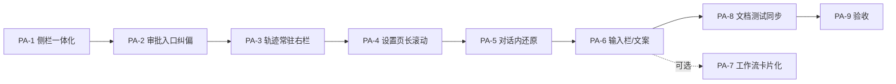

# 第一次向 v7/v8 原型靠拢：阶段规划（PA-1）

- 日期：2026-11-11
- 状态：**PA-1～PA-5 已完成并验证（2026-11-11）**；PA-6 输入栏顺序/PA-7 工作流卡片化留到下一批；PA-8 文档已同步；PA-9 验收见文末。
- 基线：`docs/prototypes/ui-v7.html`、`ui-v7-pages.html`、`ui-v8-admin.html`（2026-11-08 定稿）+ [页面规划](../../pages.md) + [路线图](../../roadmap.md) + 当前 `master`（M0–M6 + F1 已交付）
- 前提：**不新增后端契约、不调用后端 M7/M8/M9 未交付接口、不做本地假成功**；只改前端呈现、信息架构与交互。

## 0. 两个阶段

| 阶段 | 时机 | 范围 |
|---|---|---|
| **阶段 1：第一次靠拢（本文档）** | 现在，M7–M9 未开工期间 | 把已实现功能的布局、导航、审批主链路、轨迹、设置页、卡片与文案拉回 v7 原型；不新增依赖新后端的功能 |
| **阶段 2：最终靠拢** | M7/M8/M9 全部开发并联调完成后 | 管理台 v8 七页、工作流编辑器/运行历史、M7 续流/事件回放/RBAC/审批 5 字段、v7 像素级定稿 |

阶段 1 的目标不是“把原型所有演示功能做出来”，而是**消除结构性与交互性偏离**；阶段 2 才做完整还原与定稿。

## 1. 当前偏离盘点（截图 + 代码核对）

判定口径：
- **纠正**：偏离原型的信息架构或主交互，阶段 1 必须改；
- **还原**：原型有、实现简化或缺失，阶段 1 做（纯前端可完成）；
- **保留**：需求驱动的增强，原型没有但不应回退；
- **后置**：依赖 M7–M9 后端，阶段 2 做。

| # | 偏离项 | 当前实现 | v7 原型 | 判定 | 处理 |
|---|---|---|---|---|---|
| A1 | 侧栏结构 | `AppLayout` 288px 导航 + `ChatView` 272px 会话栏，对话页左侧共 560px | 单侧栏 288px：品牌 + 新建 + 导航 + 搜索 + 会话分组 + 底部状态/账号 | **纠正** | 合并为一套侧栏；对话页去掉第二栏 |
| A2 | 移动端会话可达性 | ≤900px 时 `ChatView .chat-sidebar { display:none }`，抽屉里只有导航，**无法切换/新建会话** | 移动端抽屉含会话列表 | **纠正**（功能缺陷） | 随 A1 合并解决 |
| A3 | 审批主入口 | 侧栏一级「审批」+ 独立 `/approvals` 表格页；对话内审批卡可操作但被“打开审批中心”分流 | 无审批一级导航；审批卡在对话时间线内完成批准/拒绝 | **纠正**（用户明确） | 侧栏移除审批；对话内审批卡为唯一决策入口；`/approvals` 降级为只读「审批记录」 |
| A4 | 运行轨迹 | 所有宽度都是右侧抽屉（392px） | >1180px 常驻右栏 280px；≤1180px 抽屉 | **纠正** | 宽屏常驻右栏，窄屏抽屉；内容抽成可复用面板 |
| A5 | 设置页形态 | 左侧分区导航 + `v-if` 切换，一次只显示一个分区 | 左侧锚点 + 单页长滚动（账号/个人能力/模型/A2A/界面/关于） | **纠正** | 改锚点长滚动；A2A 分区继续移除（决策已定）；保留 M5「安全与审计」分区 |
| A6 | 输入栏「+」顺序 | 附件 / 技能 / MCP / 工作流（禁用，标 `M5+`）/ 知识库 | 附件 / 技能 / 工作流 / 知识库 / MCP，底部“选择只影响当次请求” | **纠正** | 顺序对齐；工作流项保留禁用但标注改 `M9` |
| B1 | 运行轨迹内容 | 摘要 + 服务端事件列表 + 本轮过程 | 执行时间线（0–8s 轴、图例、实际/等宽）、类型筛选与计数、事件搜索、回合折叠、事件展开明细、请求事件 | **还原** | 先还原结构与关键信息；时间轴图按数据可行范围实现，不伪造 |
| B2 | Agent 输出抽屉 | 无；A2A 卡只跳任务页 | 对话内 Agent 抽屉：streaming 时逐字回放 artifact，否则等待最终结果后整段展示 | **还原** | 新增基础版（数据来自已有 `a2a.*` 事件/任务详情） |
| B3 | 过程摘要栏 | “执行过程 · N” + 收起 | “思考 12s · 7 步 · 2 个远程智能体 · 1 个审批” + 收起/展开 | **还原** | 由 process 项汇总生成；无数据项隐藏 |
| B4 | 过程卡片 | 检索/MCP 统一由 `ToolCard` + 来源标签承载 | 独立检索卡（vector）、MCP 卡，六类色板（绿/蓝/琥珀/青/紫/红） | **还原** | 按 `source` 分流卡片或变体；核对 `--kind-*` 色板 |
| B5 | 顶栏状态胶囊 | 静态 `span`，不可点 | 点击定位审批卡并聚焦“批准” | **还原** | 有 pending 审批时可点击滚动定位 |
| B6 | 审批卡文案 | “批准并继续” | “批准并执行” | **还原**（小） | 对齐原型文案；保留多审批/倒计时/遮罩（需求增强） |
| B7 | 工作流页视觉 | 只读 `el-table` | 卡片列表（名称/描述/步骤芯片/启停/运行次数） | **后置/可选** | 阶段 1 只纠正文案编号；卡片化可随 M9 一起做 |
| C1 | 管理台 v8 | 0/7 页 | 深墨侧栏 + 七页 | **后置** | 等 M8 后端（阶段 2） |
| C2 | 工作流编辑器/CRUD/运行历史 | 骨架 + mock | 卡片 + 步骤编辑器 + 运行次数 | **后置** | 等 M9（阶段 2） |
| C3 | 续流/事件回放/RBAC/审批 5 字段 | 无/部分类型预留 | 原型未体现（M7 新增需求） | **后置** | 等 M7 后端（阶段 2） |
| D1 | 文案与文档漂移 | `SideNav` 工作流标 `M5+`、`WorkflowsView` 写“M5 接入”、`pages.md` 称“路由已全部注册”、README/roadmap 测试数 232/10 | — | **纠正** | 文档与文案同步（281 单测 / 28 E2E） |

### 保留项（需求增强，不回退）

以下与原型不同但属于 M2/M4/M5/M6/F1 的需求交付，阶段 1 **不删除、不降级**：

- 对话内多审批卡、倒计时、payload 遮罩、409/超时语义（M5）；
- 知识库真实上传/轮询/检索调试/引用深链（M4）；
- 智能体两段式注册、健康检查、Card 刷新（M2）；
- 任务 8 状态、轮询、`?task=` 深链（M2）；
- 设置页「安全与审计」「平台密钥」（M5）；
- 虚拟滚动、⌘K、密度偏好、axe 门禁、断线重连、诊断抽屉、Web Vitals（F1/M6）。

这些是“原型没有、需求要求”的增强，不是偏离；阶段 1 只把它们放回原型的信息架构里（例如审计/密钥仍留在设置页，不占一级导航）。

## 2. 工作包

> 顺序：PA-1 → PA-2 → PA-3（P0 批次）→ PA-4 → PA-5 → PA-6 → PA-8（P1 批次）→ PA-7（可选）→ PA-9 验收。
> PA-1 与 PA-2 必须同批，否则导航/路由/文案会不一致。

### PA-1 侧栏一体化（P0）

**目标**：所有页面共享一套 288px 侧栏（品牌/新建/搜索/导航/会话/底部账号），对话页去掉 `chat-sidebar` 第二栏；移动端抽屉内可切换会话。

**范围**：
- `AppLayout`：侧栏内渲染 `ConversationSidebar`（或 SideNav 插槽），仅桌面非折叠时显示；移动端抽屉内显示。
- `SideNav`：增加会话区插槽/子组件；折叠 rail 时隐藏会话；移动端样式对齐原型。
- `ChatView`：删除 `chat-sidebar` 列；会话选择/新建/重命名/归档/删除逻辑移到侧栏组件或通过事件上提；保留 `?c=` 深链。
- 会话数据：`conversations` store 在布局层惰性加载，避免与对话页重复请求；切换会话仍走 `/chat?c=`。
- 响应式：≤900px 侧栏抽屉；≤1180px 内容区与轨迹断点沿用。

**验收**：
- 1440/1280/1100/390 四档截图：左侧只有一套侧栏；对话页无第二栏。
- 移动端可从抽屉新建、切换、重命名、删除会话。
- 桌面折叠为 56px rail 时会话区隐藏、可展开恢复。
- 现有会话相关单测/E2E 通过（选择器按需更新）。

**不做**：不改会话业务逻辑；不新增接口。

### PA-2 审批入口纠偏（P0）

**目标**：对话内审批卡是**唯一决策入口**；**彻底删除审批页**，审批不再出现在任何导航/命令面板中。

**范围**：
- `SideNav`：移除「审批」导航项（原型导航为 对话/工作流/智能体/任务/知识库）。
- `CommandPalette`：移除“审批”页面项。
- `ChatView`：pending 横幅文案改为“有 N 项操作等待你在对话中审批”，按钮改为**定位到审批卡**（滚动并聚焦批准）；删除“打开审批中心”跳转。
- `RunRecoveryBanner` 的 `@approvals`：改为定位审批卡，不跳页。
- `router`：删除 `/approvals` 路由。
- 删除 `src/views/ApprovalsView.vue`、`src/components/approvals/ApprovalDetailDrawer.vue`、对应测试；保留 `src/api/approvals.ts`、`src/types/approval.ts` 供 `chat` store 恢复兜底。
- `docs/pages.md`：删除 7.1 审批中心页，改为“审批在对话内完成；审批列表仅作恢复兜底”。

**验收**：
- 侧栏、命令面板均无审批入口；访问 `/approvals` 返回 404 页。
- 对话内审批卡可批准/拒绝；无跳审批页按钮。
- `e2e/approval.spec.ts`（对话内主链路）通过；`e2e/a11y.spec.ts` 移除审批页扫描后通过。
- 移动端审批卡可操作。
- 全仓库无悬挂引用（type-check/test 通过）。

### PA-3 运行轨迹常驻右栏（P0/P1）

**目标**：宽屏恢复原型三栏（侧栏 + 对话 + 轨迹），窄屏仍用抽屉。

**范围**：
- 把 `RunTraceDrawer` 的内容抽为 `RunTracePanel`（摘要/时间线/事件/过程），抽屉与常驻栏复用。
- `ChatView`：`>1180px` grid `minmax(0,1fr) 280px`，右栏常驻；`≤1180px` 保持抽屉 + 按钮。
- 右栏宽度、头部、空态、滚动行为对齐原型；运行详情按钮在宽屏可隐藏或改为“刷新/定位”。
- 保留“服务端事件回放 + 本轮过程”两个区块。

**验收**：
- 1440 三栏；1280 仍三栏（≥1181）；1180 及以下抽屉。
- 切换会话/运行结束时右栏数据正确刷新；无重复请求（打开时加载一次，切换 run 时刷）。
- axe 扫描（对话页含右栏）0 critical/serious。

**不做**：不做原型的时间轴“等宽/实际时长”像素级动画；先保证信息结构，视觉细节在阶段 2 定稿。

### PA-4 设置页长滚动 + 修改密码（P1）

**目标**：恢复原型的“锚点 + 单页长滚动”，并接通后端已存在的修改密码接口。

**范围**：
- `SettingsView`：分区顺序 **账号 / 个人能力 / 模型 / 界面 / 安全与审计 / 关于**（A2A 保持移除；安全与审计为 M5 新增，置于界面之后）。
- 内容全部渲染，左侧导航平滑滚动 + 滚动高亮；保留现有 `InstructionPanel`/`MemoryPanel`/`SkillPanel`/`McpPanel`/`AuditPanel`/`SecretPanel` 与角色门控。
- 账号区“修改密码”打开对话框：旧密码/新密码/确认，接 `POST /auth/change-password`；错误行内提示；成功后提示“密码已修改”。
- 账号区补“退出登录”（原型有；当前在账号菜单）。

**验收**：
- 滚动时左侧高亮同步；`#settings` 深链可直达分区（可选）。
- 修改密码真实可用（mock + 真实后端端点已存在）；不伪造成功。
- 移动端单列、导航横向换行（原型行为）。

### PA-5 对话内还原（P1）

**目标**：把对话内与原型差异最大的交互补齐（纯前端，数据来自现有 SSE/运行接口）。

**范围**：
1. 过程摘要栏：汇总“思考 Xs · N 步 · M 个远程智能体 · K 个审批”，无数据项隐藏；保留收起/展开。
2. 过程卡片分流：`source=knowledge` 渲染检索卡变体（命中数/分数/来源），`source=mcp` 渲染 MCP 卡变体（服务器/工具/频道）；核对六类色板。
3. 顶栏状态胶囊：有 pending 审批时可点击，滚动到第一张审批卡并聚焦“批准并执行”。
4. **Agent 输出抽屉（基础版）**：A2A 卡增加“查看输出”；抽屉展示任务信息、artifact/result、原始 JSON；若声明 streaming 展示“流式回放”样式（按已有文本分段渲染），否则显示“远程 Agent 未声明 streaming，展示最终结果”。不伪造尚不存在的 artifact。
5. 审批卡文案“批准并执行”；保留多卡/倒计时/遮罩。

**验收**：
- 摘要数字与 process 项一致；无审批时不显示审批段。
- A2A 卡可打开输出抽屉；无 artifact 时明确空态，不显示假数据。
- 审批胶囊定位正确；键盘可达。
- 新增单测（摘要计算、卡片分流、抽屉状态）。

### PA-6 输入栏与文案纠偏（P1）

**目标**：输入栏顺序、标注、提示与原型一致；清理过时文案。

**范围**：
- 「+」菜单顺序：附件 / 技能 / 工作流 / 知识库 / MCP；标题“添加上下文 / 已选 n”；底部“选择只影响当次请求，发送后清空”。
- 工作流项保留禁用，标注改 `M9`（原 `M5+`）；提示“工作流后端 M9 未交付”。
- 侧栏 stage：工作流 `M9`；移除审批项后不再出现 `M5`；智能体/任务/知识库保留 `M2/M4`。
- `WorkflowsView` 的“将在 M5 接入”改“M9 接入”；`MessageBubble` 下载文案“将在 M1.5 提供”改“下载附件”。
- 模型/推理选择位置与标签对齐原型（输入栏右侧），不改变请求字段。

**验收**：
- 菜单顺序/文案与原型一致；禁用项有可理解提示。
- `grep M5+`/`M5 接入` 不再出现在工作流相关 UI。
- 输入栏相关单测/E2E 通过。

### PA-7 工作流页卡片化（P2，可选）

**目标**：只读工作流列表从表格改为原型卡片形态（不做编辑器/CRUD）。

**范围**：`WorkflowsView` 卡片列表（名称/描述/状态/步骤数/运行次数/更新时间），保留统计与筛选；操作按钮禁用并标 `M9`。
**验收**：视觉接近原型卡片；无假 CRUD。
**建议**：若 M9 临近，可跳过，直接随 M9 实现。

### PA-8 文档与测试同步（P1）

- 新增本文档并在 `docs/roadmap.md` 增加“阶段 1/阶段 2”说明与触发条件。
- 更新 `docs/pages.md`：布局（单侧栏 + 常驻轨迹）、审批记录定位、设置页长滚动、阶段状态。
- 更新 README 测试数字（281 单测 / 28 E2E）与“原型靠拢”状态。
- 更新 `docs/prototypes/README.md` 当前状态。
- 修正 `SideNav`/`WorkflowsView`/`MessageBubble` 过时编号。

### PA-9 验收（P0 门禁）

- `pnpm test`、`pnpm type-check`、`pnpm lint`、`pnpm build`、`pnpm size`、`pnpm e2e` 全绿。
- axe：登录、对话（空态/消息态/审批态/轨迹常驻）、设置（各锚点）、知识库、审批记录、智能体、任务 0 critical/serious。
- 截图对照：1440 / 1280 / 1100 / 390 四档；与 v7 原型并排检查。
- 手工走查：侧栏会话、移动端会话、对话内审批、审批记录只读、轨迹常驻/抽屉、设置滚动、修改密码、Agent 抽屉。
- 不引入后端变更；真实联调脚本不受影响。

## 3. 执行顺序与依赖

- PA-1 与 PA-2 同批：涉及 `SideNav`、`router`、`CommandPalette`、`ChatView`、E2E，分开会中间态不可用。
- PA-4 与 PA-5 可并行（改动文件不重叠；PA-5 只动 chat 组件）。
- PA-7 视 M9 排期取舍。

## 4. 风险与回退

| 风险 | 影响 | 缓解 |
|---|---|---|
| 侧栏重构影响所有页面与 E2E 选择器 | 回归面大 | 先改布局骨架，再逐个页面验收；保留会话 `data-testid`；分批提交 |
| 全局会话列表导致重复请求/状态不同步 | 会话切换异常 | 复用 `conversations` store 缓存；布局层只加载一次；切换仍走路由 |
| 常驻轨迹挤压消息区 | 小屏体验差 | 断点 1180；≤1180 抽屉；右栏可折叠（原型有收起按钮） |
| 审批页降级影响既有使用习惯 | 用户找不到历史审批 | 审批记录保留路由与详情，入口放对话内“查看审批记录” + 命令面板可选 |
| 修改密码接口错误处理不完整 | 假成功 | 用真实端点；错误行内提示；mock 同步 |
| 还原时误改需求增强项 | 回退 M4/M5 能力 | 保留项清单作为审查依据；审查 diff 时逐项确认 |

## 5. 已确认决策（2026-11-11）

1. **审批页**：**彻底删除**。移除 `/approvals` 路由、`ApprovalsView`、`ApprovalDetailDrawer`、命令面板审批项与侧栏审批项；对话内审批卡为唯一决策入口；`approvals` API 仅保留给 `chat` store 的恢复兜底（`syncPendingApprovals` / `reconcileRunApprovals`）。
2. **侧栏会话范围**：**所有页面共享含会话列表的侧栏**（贴 v7/v7-pages）。
3. **第一批范围**：**PA-1 ～ PA-5**（侧栏一体化、审批删除、轨迹常驻、设置页长滚动+修改密码、对话内还原），并在批次末尾完成 PA-8 文档同步与 PA-9 验收。
4. **PA-6 输入栏顺序/文案**：本批只做与审批/导航相关的必要文案（侧栏、命令面板、审批卡）；输入栏顺序与工作流标注留到下一批。
5. **PA-7 工作流卡片化**：留到 M9。

> 实施约定：每个 PA 完成后记录改动与验证；PA-1/PA-2 同批落地；批次完成后统一跑门禁、出四档截图，再提交（不推送远端）。

## 6. 实施结果（2026-11-11）

| 工作包 | 状态 | 交付 |
|---|---|---|
| PA-1 侧栏一体化 | ✅ | 单侧栏（品牌/新建/导航/会话/账号）所有页面常驻；移动端抽屉可切会话；对话页去掉第二栏 |
| PA-2 审批纠偏 | ✅ | 删除 `/approvals` 路由/页面/组件/命令面板项/侧栏项；对话内审批卡唯一入口；横幅/状态胶囊/恢复横幅改为定位 |
| PA-3 轨迹常驻 | ✅ | `RunTracePanel` + 窄屏 `RunTraceDrawer`；>1180px 右侧 280px 常驻 |
| PA-4 设置页 | ✅ | 六分区长滚动锚点 + 滚动高亮；修改密码对话框接 `POST /auth/change-password`；退出登录 |
| PA-5 对话还原 | ✅ | 过程摘要（思考/步数/A2A/审批）、检索/MCP 色卡、状态胶囊定位、Agent 输出抽屉、审批按钮文案 |
| PA-8 文档 | ✅ | pages/roadmap/architecture/development/README/prototypes 同步 |
| PA-9 验收 | ✅ | 52 文件 281 单测、28 E2E、type-check、lint、build、size 通过；截图见验收记录 |

> 验证命令与结果：`pnpm test` 281 passed；`pnpm e2e` 28 passed；`pnpm type-check` / `pnpm lint` / `pnpm build` / `pnpm size` exit 0。
