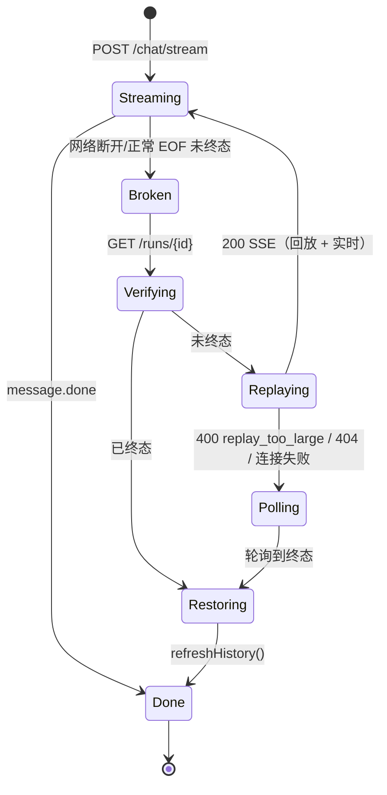

# M7–M9 前端规划对齐设计

- 日期：2026-11-11
- 状态：**M7 已实施并真实联调（2026-11-11）**；M8/M9 仍为规划。实施记录见 [M7 前端交付报告](../../handoff/2026-11-11-m7-frontend-report.md) 与 [实施计划](../plans/2026-11-11-m7-frontend-contract.md)。
- 依据：
  - 后端 [`agent-hub/docs/roadmap.md`](../../../../../PythonProjects/agent-hub/docs/roadmap.md) 的 M7/M8/M9 立项（2026-11-11）
  - 后端 [M7–M9 立项设计](../../../../../PythonProjects/agent-hub/docs/superpowers/specs/2026-11-11-m7-m9-backend-roadmap-design.md)
  - 后端 [M7 实施计划](../../../../../PythonProjects/agent-hub/docs/superpowers/plans/2026-11-11-m7-contract-security.md)
  - 后端 [项目整理报告](../../../../../PythonProjects/agent-hub/docs/feedback/2026-11-11-project-status-review.md)
  - 前端 `docs/roadmap.md`（M6/F1 交付）与 `docs/handoff/` 历史交接
- 已确认的范围选择（2026-11-11 用户拍板）：
  1. **M8 管理台前端照 v8 原型全量规划**（含角色权限、菜单、字典）；
  2. 登录 401 文案、全局 503 文案、管理员入口按角色显示三项**并入 M7 前端**；
  3. 本轮交付**规划 + 全面文档同步**（roadmap、README、api/pages/architecture、handoff）。

## 0. 结论

后端在 M0–M6 全部完成之后新增了 M7（已完成）、M8/M9（已立项、未开始）。前端按「同名同义」原则完成如下映射：

| 后端 | 后端状态 | 前端 | 前端优先级 | 前端启动条件 |
|---|---|---|---|---|
| **M7** 契约补齐与安全收口 | **已完成（2026-11-11）** | **M7 前端适配（已完成）** | 高（上线后立即） | 后端 M7 契约冻结；前端已接入并真实联调 |
| **M8** 管理台后端（原 X2） | 已立项，未开始 | **M8 前端管理台（v8 全量）** | 中 | 后端 M8 契约冻结（依赖 M7-2 RBAC） |
| **M9** 工作流后端（原 X1） | 已立项，未开始 | **M9 前端工作流** | 中低 | M9 spike 通过 + 契约冻结（含五类步骤 schema）+ 后端显式置 `capabilities.workflows=true` |

同时：

- 前端 X1 / X2 不再保留为「未立项」，**升级为 M9 / M8**；
- 纯前端收尾项不再新立 F2，**并入 M7 前端**（F 编号只保留 F1 已完成的体验与可访问性）；
- 本轮先完成规划与文档对齐，**不改业务代码**；M7 前端实现等后端契约细则（handoff/OpenAPI）落地后开工。

## 1. 背景与基线

### 1.1 后端这次做了什么

1. 完成 M0–M6：582 tests、迁移 head `2d8f6a1c3e70`、OpenAPI 62 路径 / 86 操作；
2. 整理项目文档，修正迁移 head、M4/M5 状态、回放端点表述等偏差（详见后端项目整理报告 §5.6）；
3. 新增 M7/M8/M9 立项：
   - **M7**：补齐前端反复提出的契约缺口（事件回放 `event`、SSE 续流、写操作 RBAC、审批事件字段、A2A 授权 URL 白名单）；
   - **M8**：管理台后端，替代运维脚本/DB 配置；
   - **M9**：工作流后端，轻量步骤模板 MVP，先 spike。

### 1.2 前端当前基线（2026-11-11）

| 项 | 现状 |
|---|---|
| 里程碑 | M0–M6 前端已完成；M3 入站已取消；F1 体验与可访问性已完成 |
| 测试 | `pnpm test` 44 文件 / 232 用例；`pnpm e2e` 10 例（mock 构建）；`smoke:m4` 41/40、`smoke:m5` 163 项 |
| 已知缺口 | 断线不能增量续流；agents/tasks 无真实 RBAC；审批事件字段少于详情；工作流仅骨架 + mock；管理台仅 v8 原型 |
| 环境限制 | 本机 `LLM_API_KEY` 为占位符（聊天 401），真实长流/审批恢复无 HTTP 证据；E2E 只跑 mock 构建 |

### 1.3 前端自修项（后端整理报告 §4.3）

| # | 项 | 现状 | 归属 |
|---|---|---|---|
| B-1 | 登录失败文案被 401 拦截器吞掉 | 登录 401 进入 refresh 流程，展示「登录已过期」而非后端 `error.message` | M7 前端 |
| B-2 | 全局 503 文案未统一 | 知识库检索面板有专用文案；缺 `database_unavailable` / 通用 `service_unavailable` 的统一提示 | M7 前端 |
| B-3 | 管理员入口靠隐藏而非角色 | 普通用户入口隐藏，但无真实 403 路径证据 | M7 前端 |
| B-4 | 文档状态过时 | README 停在 M1.5/M2、测试数 180、E2E 未做；roadmap 写后端 M6「进行中」 | 本轮文档同步 |

## 2. 编号与对齐规则

1. **M 编号同名同义**：前端 M7/M8/M9 与后端一一对应，只描述同一里程碑下的前端交付；不再单独定义一套里程碑。
2. **X1 / X2 升级**：后端立项后，前端 X1 → M9、X2 → M8；历史文档中的 X1/X2 保留为「原编号」，新文档一律用 M9/M8。
3. **F 系列只承载纯前端横切**：F1 已完成；原计划的 F2 收尾项并入 M7 前端，不新立编号。未来纯前端工作（如 v7 像素级视觉还原、拖拽编排器）按需新立 F3+。
4. **契约先行，真实联调才算完成**：状态口径仍为 `未开始` → `契约先行` → `实现中` → `已联调`；mock 通过只算「实现中」。
5. **不伪造后端能力**：无契约页面只做只读/内置数据呈现，并显式提示「后端未提供接口」，不做本地假 CRUD、不显示假成功。

## 3. M7 前端适配（高优先）

### 3.1 目标

让前端在 M7 后端落地后能够：

1. 断线后从 `lastSeq` **增量续流**（回放已落库事件 + 接续实时），终态仍用 `refreshHistory()` 补齐断线窗口内未落库的文本；
2. 用事件回放的 `event` 字段做 reducer 重放（补工具卡/审批卡/消息）；
3. 正确处理 agents/tasks 写操作的 403，并按角色真实显隐管理员入口；
4. 审批卡直接消费 `approval.required` 的 5 个新字段（实施后仍保留 `GET /approvals?run_id=` 作为断线补卡/对账兜底，每次 `run.interrupted` 一次；未做「仅缺字段才请求」的进一步收敛）；
5. 跟随后端更严格的 A2A 授权 URL 白名单（前端已有 https/localhost 限制，无需新增放行逻辑）；
6. 修掉登录 401 文案、全局 503 文案两个纯前端问题，并补真实 403 文本证据。

### 3.2 范围

| 子项 | 内容 | 依赖后端 |
|---|---|---|
| M7-F1 续流 | 接入 `GET /runs/{id}/stream?after_seq=`；重连路径改为「续流优先、失败回退轮询」 | M7-1 |
| M7-F2 事件回放 | `RunEventOut.event` 进入类型；reducer 可按事件名重放；补卡与去重 | M7-1 |
| M7-F3 权限边界 | agents/tasks 写入口按 `role=admin` 显隐/禁用；403 `forbidden` 文案；管理员入口按角色 | M7-2 |
| M7-F4 审批字段 | `approval.required` 5 字段直接渲染；详情请求保留为兜底 | M7-3 |
| M7-F5 授权链接 | 前端已有 https + localhost 限制；补「后端会置空非法 URL」的容错用例 | M7-4 |
| M7-F6 纯前端收尾 | B-1 登录 401 文案、B-2 全局 503 文案、B-3 管理员入口（与 M7-F3 合并验收） | 无 |
| M7-F7 契约与门禁 | 类型/mock/fixtures/OpenAPI 手写类型同步；单测与联调用例 | M7-1..4 |

### 3.3 契约（以 M7 立项与实施计划为基线，落地以 handoff/OpenAPI 为准）

#### 3.3.1 运行事件回放

```http
GET /api/v1/runs/{run_id}/events?after_seq=&limit=
```

- 响应元素新增 `event: string`：原始 SSE 事件名（如 `message.delta`、`approval.required`、`message.done`）；
- `type` 仍保留分类（run/message/tool/approval/…）；
- `payload` 继续剔除内部字段 `_event`；
- 旧字段零变化；`event` 为空/缺失时按未知事件忽略并记录 `type`/`seq`，不猜测事件名（`payload` 不保留 `_event`）。

#### 3.3.2 SSE 续流端点

```http
GET /api/v1/runs/{run_id}/stream?after_seq=0
Authorization: Bearer <token>
Accept: text/event-stream
```

- 帧格式与 `POST /chat/stream` 一致：`id: <seq>`、`event: <名称>`、`data: <JSON>`，每 15s `: ping`；
- 先回放 `seq > after_seq` 的已落库事件，再订阅实时事件；终态事件后关闭；
- run 已终态：回放完即关闭；`interrupted`：保持连接等审批恢复；
- 错误：未登录 401；非本人/不存在 404（不泄露存在性）；回放超过 1000 条 400 `replay_too_large`；
- 单实例前提；不提供 `Last-Event-ID`，用 query `after_seq`；
- 前端必须用 `fetch`/`@microsoft/fetch-event-source`（EventSource 不支持自定义 Authorization）。

#### 3.3.3 写操作 RBAC

- agents 写接口（`POST /agents`、`PATCH/DELETE /agents/{id}`、`refresh`、`health`）与 tasks 动作接口（`cancel/resume/authorize/reject`）改为仅管理员；
- 普通用户返回 403 `forbidden`，`details.required_role="admin"`；
- 读接口 `GET /agents*`、`GET /tasks*` 与 `POST /agents/preview` 保持登录用户可用；
- 被拒绝的写操作后端记审计 `security.rbac_denied`。
- **行为变更**：M7 前普通用户本可调用这些写接口（前端只是隐藏入口）；M7 后统一 403。前端需准备普通用户第二账号，补「入口不可见 + 直接调用 403」两层回归，不能当成「新增按钮权限」。

#### 3.3.4 审批事件字段

`approval.required.data` 新增：

```text
tool_display_name  string   工具展示名
executor           string   执行方（native/skill/mcp/a2a）
target             string   操作目标（≤2000）
side_effect        string   副作用/风险说明
payload_preview    string   脱敏后的参数预览（≤500）
```

字段只增不减；前端可直接渲染审批卡，`GET /approvals?run_id=` 保留为兜底。

#### 3.3.5 A2A 授权 URL

- 后端只允许 `https`，dev/test 额外允许 `http://localhost`、`http://127.0.0.1`；
- 非法协议、内网/回环（prod）、超长（>2000）一律置 `authorization_url=null`，任务状态不变；
- 前端已有「仅 https/本地 http」判断；无链接时显示「授权链接不可用，请联系管理员」而不是空按钮。

### 3.4 前端设计

#### 3.4.1 文件影响

| 文件 | 改动 |
|---|---|
| `src/types/run.ts` | `RunEvent` 增 `event: string`；续流参数类型 |
| `src/types/chat.ts` | `ApprovalRequiredPayload` 增 5 字段；事件白名单不变 |
| `src/api/runs.ts` | 新增 `openRunStream(runId, opts)`：`fetchEventSource` GET + Bearer + `after_seq`；`onEvent(name, data, seq)`；返回 `AbortController` |
| `src/stores/chat.ts` | 重连 action 改造：断线 → 校验 run → 续流（`lastSeq`）→ 去重消费；400 `replay_too_large`/连接失败 → 回退现有轮询 + `refreshHistory`；终态关闭 |
| `src/stores/auth.ts` | 暴露 `isAdmin`（`user.role === 'admin'`）供入口显隐 |
| `src/api/client.ts` | 401 拦截排除登录/注册/刷新；`handleApiFailure` 增加 403 `forbidden` 与 503 统一文案 |
| `src/views/AgentsView.vue` / `src/views/TasksView.vue` | 写按钮按 `isAdmin` 显示；403 时提示并刷新 |
| `src/components/chat/cards/ApprovalCard.vue` | 优先用事件 5 字段；缺字段时保留详情兜底 |
| `src/components/layout/SideNav.vue` / `router` | 管理台入口按角色显示（M8 页面落地前先保留设置页管理员分区） |
| `src/api/mock/` | 新增续流 mock、`event` 字段、403 脚本、审批 5 字段；fixtures 同步 |
| `deploy/nginx.conf` / `deploy/README.md` | 新增 `GET /api/v1/runs/{id}/stream` 的 SSE location（`proxy_buffering off` / `proxy_cache off` / `gzip off` / 长读超时）；否则生产续流会被缓冲或 60s 读超时截断 |
| `scripts/verify-nginx-sse.mjs` | `pnpm verify:nginx` 增加续流路径的逐帧对照（复用 chat/stream 的验证方式） |

#### 3.4.2 续流状态机



要点：

- 续流连接前必须完成 run 校验，避免对非法/他人 run 建流；
- 回放事件与实时事件统一走现有 reducer，按 `seq` 单调去重（`lastSeq` 只前进）；
- 续流期间保留「正在恢复连接」可中断提示；
- 续流失败不弹致命错误，降级到轮询并保留恢复横幅；
- 收到终态事件立即停止续流并 `refreshHistory()`，防止重复连接。

#### 3.4.3 权限与错误 UX

- `isAdmin` 只控制入口显隐与按钮禁用；**不伪造后端拒绝**，真正的边界仍由 403 证明；
- 403 `forbidden` 统一提示「当前账号无管理员权限」+ 可复制 `request_id`；不把 403 当登录失效；
- 登录 401：排除 `/auth/login`、`/auth/register`、`/auth/refresh` 的全局刷新流程，直接展示后端 `error.message`（如「邮箱或密码错误」）；
- 503 `database_unavailable` / `service_unavailable` 统一提示「服务暂不可用，请稍后重试」，知识库检索面板保留专用文案。

#### 3.4.4 mock 与 fixtures

- mock 新增 `GET /runs/{id}/stream`：按 `after_seq` 回放 fixtures，再按脚本推送实时事件；
- mock 的 `GET /runs/{id}/events` 元素补 `event`；
- mock 增加普通用户写 agents/tasks 的 403 脚本（用 `admin@example.com` 与普通账号区分）；
- 审批事件 fixtures 补 5 字段，旧 fixtures 保留兼容用例。

### 3.5 验收与门禁

| # | 验收 | 证据 |
|---|---|---|
| 1 | 断线后从 `lastSeq` 续流：已落库事件回放 + 实时事件不重复；断线窗口未落库的 `message.delta` 由终态 `refreshHistory()` 补齐（不承诺逐字补齐） | store 单测 + mock 续流 E2E |
| 2 | `400 replay_too_large` 回退分页/轮询，不卡死 | 单测 |
| 3 | run 已终态时续流立即关闭，随后 `refreshHistory()` | 单测 |
| 4 | `GET /runs/{id}/events` 的 `event` 可驱动 reducer 补卡 | 单测 + mock 回放 |
| 5 | 普通用户 agents/tasks 写入口不可见；直接调用 403 文案正确 | 单测 + 真实 403 用例（需第二账号） |
| 6 | 管理员入口与写按钮按 `role` 显示 | 单测 + E2E |
| 7 | 审批卡直接用事件 5 字段渲染；缺字段时兜底请求 | 单测 |
| 8 | 登录 401 显示后端文案，不触发刷新；503 文案统一 | 单测 |
| 9 | 全量门禁 | `pnpm test` / `type-check` / `lint` / `build` / `e2e`（mock） |
| 10 | 真实联调 | 后端 M7 落地后 `pnpm test:real`（新增 M7 用例）；LLM key 仍占位时标注限制 |

### 3.6 非目标与风险

**非目标**：

- 跨实例续流、`Last-Event-ID`、服务端广播；
- `message.delta` 落库；
- 取消/排水期间的新流拦截（后端 M7 默认不做）；
- 用 localStorage 伪造角色。

**风险**：

| 风险 | 应对 |
|---|---|
| 续流端点鉴权遗漏泄露他人 run | 前端先 `GET /runs/{id}` 校验；后端 404 用例必须覆盖 |
| 回放上限 1000 条 | 400 时回退分页/轮询，不重试同一 `after_seq` |
| 单实例限制 | 前端不做跨实例假设；文档记录 |
| 真实 LLM key 占位 | mock + 单测取证；真实 HTTP 证据等 key 就位后补 |
| 续流与旧轮询并存导致重复渲染 | 统一 reducer + seq 去重；状态机互斥 |

## 4. M8 前端管理台（v8 原型全量）

### 4.1 目标

把 v8 原型的管理控制台落成真实页面：有契约的页面接真实接口，无契约的页面以只读/内置数据呈现并明确标注，**绝不伪造写成功**。

### 4.2 页面与契约映射

| 页面 | 路由 | 后端 M8 契约 | 前端处理 |
|---|---|---|---|
| 概览 | `/admin` | `GET /admin/overview` | 真实计数卡片：用户/会话/run/任务/知识库/存储 |
| 用户 | `/admin/users` | `GET /admin/users`、`GET /admin/users/{id}`、`PATCH /admin/users/{id}` | 真实分页/搜索/角色/状态；不能修改自己的 role、不能禁用/降级最后一个 admin（自己能否改 status 以 M8 handoff 为准）；前端禁用 + 后端校验 |
| 角色权限 | `/admin/roles` | **无**（v1 仅 user/admin） | 只读：两角色说明 + 用户角色分布（来自 `/admin/users`）+ 内置能力矩阵；不做新建角色/权限编辑，页面标注「v1 固定两角色」 |
| 菜单 | `/admin/menus` | **无** | 只读：展示前端路由菜单树（来源：`router` 路由表）；标注「前端内置，后端无菜单配置接口」 |
| 字典 | `/admin/dictionaries` | **无** | 只读：展示前端内置枚举（任务状态、审批风险、知识库状态等）；标注「前端内置枚举，后端无字典管理接口」 |
| 审计 | `/admin/audit` | 已有 `GET /admin/audit-logs`（M5） | 复用 `AuditPanel` 管理员模式 |
| 系统设置 | `/admin/settings` | 平台指令 `GET/PUT /admin/settings/instruction`；系统技能 `GET /admin/skills`、`PUT .../enabled`、`.../force-disable`；系统 MCP `GET/POST/PATCH/DELETE /admin/mcp/servers`；全局 Agent `GET/PATCH /admin/agents`；密钥已有 `/admin/secrets` | 分区 Tab；写操作均有审计；`secret:` 引用用已有密钥选择器 |

### 4.3 前端设计

- **路由**：`/admin` 独立布局 `AdminLayout`（深墨侧栏 + 七个二级页），与 v8 原型一致；`meta.requiresAdmin`，非 admin 重定向到 403 页或对话页；
- **入口**：侧边栏「管理」仅 `isAdmin` 显示；M7 前端先按角色显隐，M8 后端落地后补 403 真实验证；
- **数据层**：新增 `src/api/admin.ts` 与 `src/types/admin.ts`；有契约页面走真实 API，无契约页面从 `src/api/admin/builtin.ts` 读取前端内置只读数据；
- **组件**：`AdminOverview`、`AdminUsers`、`AdminRoles`、`AdminMenus`、`AdminDictionaries`、`AdminSettings`；审计/密钥复用现有组件；
- **降级**：无契约页面统一显示顶部提示条「后端暂未提供该配置接口，本页为只读展示」，禁用新建/编辑/删除按钮并给出原因；
- **空态/错误态**：三态组件统一；403 显示无权限页，403 以外的错误按 `handleApiFailure` 统一文案。

### 4.4 验收

| # | 验收 | 证据 |
|---|---|---|
| 1 | 管理员可查看概览、用户列表、改角色/状态；规则拦截（改自己的 role、最后一个 admin） | mock 单测 + 真实 smoke（M8 后端后） |
| 2 | 系统指令/技能/MCP/全局 Agent 可读可改，写操作有审计 | 同上 |
| 3 | 无契约页面只读且提示明确，无假 CRUD | E2E 断言按钮禁用 + 提示文案 |
| 4 | 普通用户访问 `/admin/*` 显示无权限；后端 403 | 单测 + 真实用例（M7-2 后） |
| 5 | 七个页面 axe 无 critical/serious | E2E |

### 4.5 非目标与风险

**非目标**：多角色 RBAC、菜单/字典写操作、数据导出/批量操作、密码重置/强制下线（后端 M8 非目标）。

**风险**：

- v8 全量页面中 3 页无后端契约；只能只读。若用户要求可编辑，需要后端补充立项（候选 M10+），前端不先造假；
- 管理端写操作影响面大：前端二次确认 + 后端规则（不能修改自己的 role、不能禁用/降级最后一个 admin；自己能否改 status 以 M8 handoff 为准）+ 审计三件套缺一不可；
- 依赖 M7-2 RBAC；M7 未落地前管理台只能 mock 验收。

## 5. M9 前端工作流

### 5.1 目标

把 `/workflows` 骨架 + mock 升级为真实工作流管理：列表、线性步骤模板编辑、启停、运行历史；对话中按 `workflow_id` 运行并渲染 `workflow.step` 事件。

### 5.2 契约（基于后端 M9 MVP）

- `GET/POST /workflows`、`GET/PATCH/DELETE /workflows/{id}`、`PUT /workflows/{id}/enabled`；
- `GET /workflows/{id}/runs`；
- `POST /chat/stream` 新增 `workflow_id`；`capabilities.workflows=true`；
- SSE 新增 `workflow.step`（步骤开始/完成/失败/等待审批）；
- 步骤类型五类：`knowledge_search`、`tool`、`a2a`、`approval`、`answer`。

### 5.3 前端设计

- **列表页** `/workflows`：名称、描述、步骤数、启用状态、归属（系统/用户）、更新时间；新建/编辑/启停/删除/运行；
- **编辑器** `/workflows/:id`：线性步骤列表（增删/上移下移），每类步骤参数表单（**以下字段为前端草案，待 M9 handoff 冻结 `steps` JSONB schema**）：
  - `knowledge_search`：查询模板、分类、top_k；
  - `tool`：工具/技能/MCP 选择 + 参数；
  - `a2a`：远程 Agent 选择 + 消息模板；
  - `approval`：审批说明/风险；
  - `answer`：回答提示；
  - 保存前校验：至少一步、步骤类型合法、必填参数齐全；不做拖拽画布；
- **运行**：输入栏「+ → 工作流」在 `capabilities.workflows=true` 时开放；发送带 `workflow_id`；时间线渲染步骤卡（状态、耗时、审批跳转）；
- **运行历史**：`GET /workflows/{id}/runs` 列表 + 关联 run 详情；
- **降级**：后端未就绪时保持现有骨架 + mock，并在页面标注「M9 契约未冻结」；`capabilities.workflows=false` 时导航置灰。

### 5.4 验收

| # | 验收 | 证据 |
|---|---|---|
| 1 | 3 步模板（检索 → A2A → 审批）可保存并运行 | mock 单测 + 真实 smoke（M9 后端后） |
| 2 | `workflow.step` 在时间线可见，状态与 run 一致 | 单测 + E2E |
| 3 | 取消/失败/审批超时语义与现有 run 一致 | 单测 |
| 4 | `workflows=false` 时入口置灰、路由退回 | 单测 |

### 5.5 非目标与风险

**非目标**：DAG/并行/条件跳转、外部工作流引擎、拖拽编排器（后端明确非目标；前端列 F3 候选）、跨用户共享（v1 系统模板 + 用户自建）。

**风险**：

- M9 是三个里最容易范围膨胀的：前端编辑器只做线性列表，不做画布；
- 依赖 M7 续流与 M9 spike；spike 不通过则 M9 前端不启动；
- `workflow.step` 事件契约未冻结前不写死类型。

## 6. 纯前端收尾（并入 M7 前端）

| 项 | 改动 | 验收 |
|---|---|---|
| B-1 登录 401 文案 | `client.ts` 拦截器排除 auth 端点；登录页直接展示后端 message | 单测：错误密码显示「邮箱或密码错误」，不触发 refresh |
| B-2 全局 503 文案 | `handleApiFailure` 统一 `database_unavailable`/`service_unavailable` | 单测：503 显示统一文案 |
| B-3 管理员入口 | `isAdmin` 驱动侧栏/设置页管理员分区显隐 | 单测 + E2E（管理员/普通用户两套） |
| 文档状态 | README/roadmap 状态、测试数、E2E 状态同步 | 本轮完成 |

> F1 已完成项不再重复：虚拟滚动、⌘K、三态统一、a11y、密度偏好、Markdown 缓存。服务端偏好同步仍待后端接口（M8 未包含），继续记录。

## 7. 文档同步清单（本轮）

| 文档 | 同步内容 |
|---|---|
| `docs/roadmap.md` | 新增 M7/M8/M9 前端里程碑；X1/X2 升级；M6 后端改已完成；F1 状态；契约门禁表；变更记录 |
| `README.md` | 状态段更新到 M6/F1；测试数 232；E2E 已覆盖；路线对齐提到 M7/M8/M9 |
| `docs/api.md` | 新增 M7 契约草案（续流/事件/RBAC/审批字段/授权 URL）；更新 §11 缺口表与 §12.5 |
| `docs/pages.md` | 智能体/任务写权限归 M7；审批事件字段；新增 M8 管理台七页、M9 工作流页；契约缺口表更新 |
| `docs/architecture.md` | 续流状态机、事件回放；管理台模块；工作流模块；store/路由表 |
| `docs/development.md` | 状态段、常用命令（232 单测、e2e/size/verify:nginx）、联调环境文件修正 |
| `docs/handoff/README.md` | 2026-11-11 编号升级说明（X1→M9、X2→M8）；变更记录 |
| `docs/handoff/2026-11-11-m7-m9-alignment.md` | 新增：M7–M9 前端对齐交接（契约、页面、依赖、验收、未覆盖项） |

## 8. 排期与依赖

```text
本轮：文档对齐
  ↓
M7 前端（契约先行，与 M7 后端并行）
  ├─ 类型/mock/纯前端收尾（B-1/B-2/B-3）
  ├─ 续流/事件回放/RBAC/审批字段（后端契约冻结后）
  └─ 联调与门禁（M7 后端落地后）
  ↓
M8 前端（M8 后端落地后）
  ├─ 有契约页面：概览/用户/系统项/审计
  └─ 无契约页面：角色权限/菜单/字典（只读 + 提示）
  ↓
M9 前端（M9 spike 通过 + 契约冻结后）
  ├─ 列表/线性编辑器/启停/运行历史
  └─ 对话 workflow_id + workflow.step
```

- M7 前端是唯一现在就能开工的（类型与 mock 不依赖后端代码，只依赖冻结的契约草案）；
- M8 前端依赖 M8 后端；在 M8 后端启动前只做页面设计与内置只读数据；
- M9 前端依赖 M9 spike 结论；spike 不通过不进入实现；
- F1 剩余项（v7 像素级视觉还原、真实后端 E2E 取证）不排进 M 编号；当前维持 mock 构建 E2E，真实链路靠 `smoke:real`/`test:real`，作为 F3 候选。

## 9. 待决策

| 议题 | 选项 | 当前结论 | 影响 |
|---|---|---|---|
| M8 无契约页面（角色权限/菜单/字典） | 只读内置数据 / 等后端补契约 / 前端 mock 可编辑 | 只读 + 明确提示（本轮确认全量页面，但拒绝假 CRUD） | 若要求可编辑，需后端另立项 |
| M9 编辑器形态 | 线性步骤列表 / 拖拽画布 | 线性列表（后端 MVP 非目标） | 画布列 F3 候选 |
| 服务端偏好同步 | 并入 M8 / 等后端接口 / 不做 | 等后端接口；M8 后端未包含 | 设置页偏好仍本地存储 |
| 真实 LLM key 取证 | 等 key / 用 fake 模型 | 等用户配置；不伪造真实长流证据 | M7 续流真实 HTTP 证据 |
| 多实例续流 | 粘性会话 / Redis 总线 / 前端轮询 | 后端单实例，候选 M10+；前端不做跨实例假设 | 扩容前不启动 |

## 10. 变更记录

| 日期 | 变更 |
|---|---|
| 2026-11-11 | 首版：对齐后端 M7/M8/M9 立项；X1→M9、X2→M8；F2 并入 M7；确认 M8 v8 全量（无契约页面只读）；输出文档同步清单与排期 |
